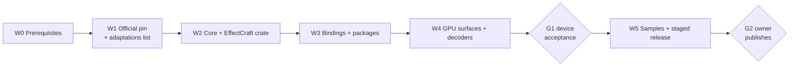

# EffectCraft Plugin Port — CONNECTIONS

<!-- GENERATED from EFFECTCRAFT-PLUGIN-PORT-SCOPING.md by build/build-plan.mjs — do not edit this file. -->
> **Generated view** of the plan of record [`EFFECTCRAFT-PLUGIN-PORT-SCOPING.md`](./EFFECTCRAFT-PLUGIN-PORT-SCOPING.md) (rendered: [`EFFECTCRAFT-PLUGIN-PORT-PLAN.html`](./EFFECTCRAFT-PLUGIN-PORT-PLAN.html)). Edit the master, then run `node build/build-plan.mjs`.

## 26. Backwards compatibility and rollout

CraftBridge is new, so compatibility is with EffectCraft's documents and releases, with devices, and with apps that take later CraftBridge versions.

| ID | Scenario | Expected | Why |
|---|---|---|---|
| B1 | A project saved by the desktop app at the pinned engine version is opened on a phone | identical document; CPU frames byte-identical | same engine at the same revision (`evidence/03-device-feasibility.md` Finding 4) |
| B2 | A project saved on a phone is opened on the desktop | identical document | the same `.ecproj` writer |
| B3 | A project from a newer EffectCraft than the SDK's pin | the engine's own version handling, as an older desktop app would | the `.ecproj` envelope is EffectCraft's (`craft-ecproj-format`) |
| B4 | EffectCraft adds commands | new generated methods in the next CraftBridge minor version | §21, §24 |
| B5 | EffectCraft removes or renames a command or key | the update reports a breaking change; the next CraftBridge version is a major version and its notes list the removals | §21 diff |
| B6 | A device whose GPU lacks what the compositor needs | renders on the CPU; frames byte-identical to the desktop's CPU frames | L7, §17 |
| B7 | An Android device offering only GL | CPU rendering | GL is never requested (§17) |
| B8 | iOS app in the background without the GPU entitlement | an export started after the suspend renders on the CPU; one already running keeps its device until it ends, under a background task, or is cancelled before the app is suspended (`BackgroundController`, §22) | L7, §17 |
| B9 | Footage in a codec or profile without a hardware decoder | software decoding, identical frames | §18 |
| B10 | One app wants EffectCraft and a later FilmCraft plugin | one combined native library | §20 |
| B11 | An EffectCraft update changes code an adaptation relies on | the update names the adaptation, which is rechecked before the update merges | §15, §24 |

**Build order.** Each wave is usable on its own, and nothing is published until the owner says so.

| Gate | Passes when | Decides |
|---|---|---|
| G1 | the conformance corpus passes on the three acceptance devices and V2–V5 are closed | W5 starts |
| G2 | the owner says to publish | the packages are published (the repository is already public once hosted CI runs, PD3) |

**Switches.** GPU (`GpuChoice.cpuOnly`), hardware decoding (`hardwareDecoding = false`), plug-ins (`Folders.plugins = nil`), background GPU (`BackgroundPolicy`). Each is a host-app setting; none needs a CraftBridge release.
