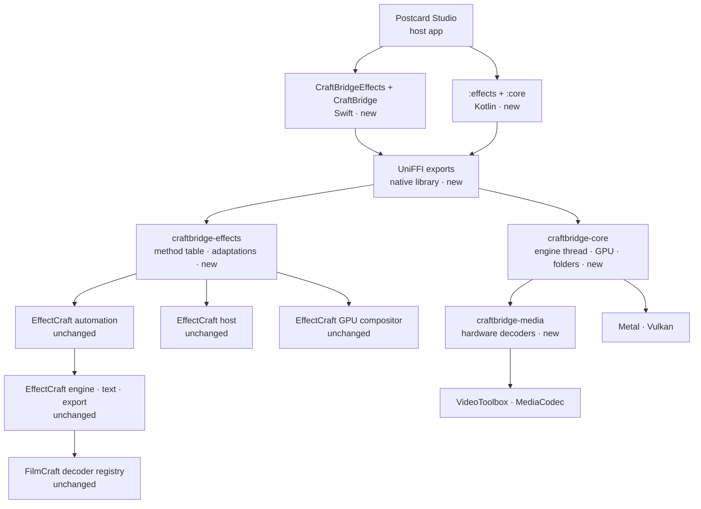
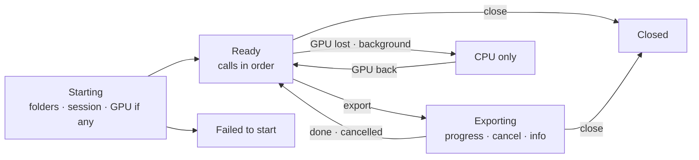
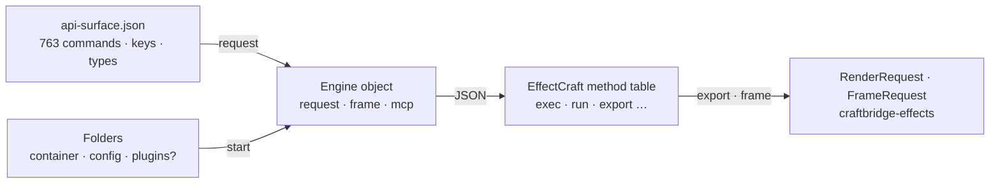
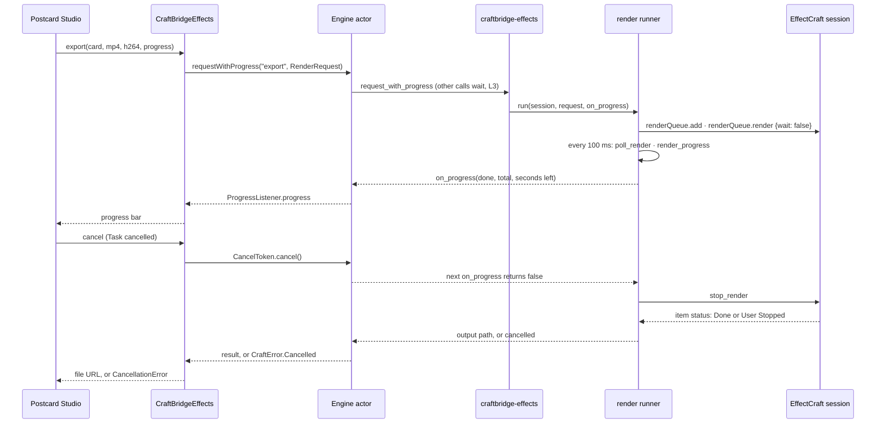
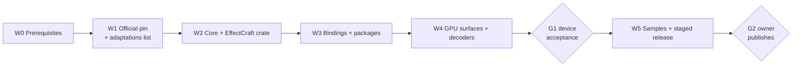

# EffectCraft Plugin Port: CraftBridge for iOS and Android — Scoping & Plan of Record

| | |
|---|---|
| **Status** | Plan of record · 12 Nov 2026. 19 product decisions (§6). Build starts after the prerequisites in §32. |
| **Owner** | ChristopherLinnett (PD1) |
| **Surfaces** | `effectcraft` (storytold/effectcraft) · `origin/main` @ `10376058` — the engine, never modified: CraftBridge builds this official revision as it is and adapts it in its own crates (§15) · `filmcraft` (storytold/filmcraft) @ `d5ead4ba` — EffectCraft's own pin of FilmCraft's codecs, read for the decoder registry · `craft-libs` (storytold/craft-libs) @ `e7c3dda` — EffectCraft's pin of the shared Craft libraries · `figcraft` (storytold/figcraft) `origin/main` @ `a4251ca8` — read for the universal-core assessment only · **new:** `ChristopherLinnett/craftbridge`, private until hosted CI starts (PD3), checked out at `artcraft-plugin-port/` with one folder per platform (PD19), and `ChristopherLinnett/craftbridge-swift`, which each release writes for Swift Package Manager (D-24) |
| **Hard constraint** | "Everything the CLI variant of effectcraft can do, can be done on Android/iOS plugins." "iOS is natively connected to what it uses as opposed to generic GPUs etc, and similar for android processes." Upstream changes must be "EASY to replicate … if not deterministic". No code is copied into a second place: reuse, extend or promote it instead (the owner's standing rule). |
| **How to read this** | **Part A** (§1–§11) is the business view: what, why, for whom, decisions, rollout, success. **Part B** (§12–§30) is the technical design, surface by surface. **Part C** (§31–§33) is delivery: team task lists, prerequisites, sign-off. Appendices hold the module inventory, the engineering decisions, sources and glossary. |
| **This file is the single source of truth** | Every per-team file (`DECISIONS.md`, `CONNECTIONS.md`, `MODULES.md`, `modules/`, `tasks/`, `contracts/`, generated code) is **generated** from tagged sections of this document by `node build/build-plan.mjs`. Edit here, never there. The rendered version is [`EFFECTCRAFT-PLUGIN-PORT-PLAN.html`](./EFFECTCRAFT-PLUGIN-PORT-PLAN.html). |

---

# Part A — The business view

## 1. Executive summary

**CraftBridge** lets an iOS or Android developer put EffectCraft's motion-graphics engine inside their own app. A Swift package and a Kotlin library expose **everything the EffectCraft command line can do** as device APIs: open and save projects, run any of the engine's 763 commands, inspect and edit properties, preview, render frames and export video. The developer brings the interface; CraftBridge brings the engine (PD8).

It works on four ideas:

1. **The same engine, not a port.** CraftBridge compiles EffectCraft's own engine for phones, at an official revision and never modified; whatever a phone needs done differently is adapted inside CraftBridge, on EffectCraft's public interfaces (PD4, PD5). On the CPU, a frame rendered on an iPhone, an Android phone and the desktop app is byte-for-byte the same (`evidence/03-device-feasibility.md` Finding 4).
2. **Native on each platform.** The engine's GPU compositor draws through Metal on iOS and Vulkan on Android, and video footage decodes on the phone's hardware decoder where it has one (PD12, PD18).
3. **Generated from EffectCraft itself.** The Swift and Kotlin APIs are generated from the engine's own command list. Taking a new EffectCraft release is one script: move the pin, regenerate, compare the API, name the adaptations whose EffectCraft code changed, run the conformance suite (PD4).
4. **A universal core.** The parts every Craft app needs on a phone (the request channel, progress and cancellation, the GPU device, folders, fonts, hardware decoding) live in a core that knows nothing about EffectCraft. A future FilmCraft plugin imports the same core (PD9, PD10).

**Commercial position.** An independent SDK by ChristopherLinnett, "based on EffectCraft by the ArtCraft team", licensed MIT OR Apache-2.0 like EffectCraft, in a repository that is private until hosted CI starts and public from then on (PD2, PD3, PD16). There is no price.

**Footprint.** One new repository (`ChristopherLinnett/craftbridge`, one folder per platform) and the Swift distribution repository each release writes (`ChristopherLinnett/craftbridge-swift`). EffectCraft is not touched: the seven places where a phone needs something done differently are CraftBridge adaptations, each listed with the EffectCraft code it relies on, so an update shows which ones to recheck (§15, PD5).


## 2. The problem and the opportunity

**Today**, EffectCraft runs on desktops and in the browser. A developer who wants motion graphics inside a phone app has no way to use it: the engine ships only inside the desktop app, its command-line program and its web build. They choose between a cloud render service (latency, cost, the user's media leaves the phone), a much smaller mobile animation library (no compositing, effects or exports of this depth) or nothing.

**What makes it cheap now.** EffectCraft's design already separates the engine from its interface. Every action is a command with an id, which the desktop interface, the command line, the control channel and the agent (MCP) server all call the same way (`evidence/01-system-inventory.md` Findings 8 and 10). The engine builds for phones as it is: its command-line program ran its full document workflow on an iPhone simulator and an Android emulator, with the GPU compositor on Metal and Vulkan (`evidence/03-device-feasibility.md` Findings 1–7).

**Demand.** EffectCraft's own tracker asks for mobile support (storytold/effectcraft#1410, open), and two contributors are porting the desktop editor itself to iOS and Android (#1401, #2361). CraftBridge does something different: it offers the engine to other apps, without the desktop editor. There is no usage data for mobile EffectCraft yet; the first measures come from the conformance suite and the sample apps (§9).

## 3. Customer narrative (PR/FAQ)

> **CraftBridge brings EffectCraft's motion-graphics engine to iOS and Android apps.** Postcard Studio, a small greeting-card app, now lets its users turn a photo and a name into a polished six-second animated card without leaving the app or uploading anything. "I designed the card in EffectCraft on my Mac, dropped the template into my app, and CraftBridge renders it on the phone: same output as the desktop, previewed live in my own view, exported as an MP4 the user can share," says Leo, Postcard Studio's developer. CraftBridge is a Swift package and a Kotlin library; every command EffectCraft's command line offers is a method call.

| Question | Answer |
|---|---|
| What can my app do with it? | Everything the EffectCraft command line does: create and edit projects, run any engine command, read and set properties and expressions, render frames, export H.264, HEVC, AV1, ProRes, WebM, GIF, image sequences and audio, render templates, run scripts, replay repro scripts, talk to on-device agents over MCP and measure render times (§4, PD6). |
| Does it include an editor interface? | No. It renders into your view or gives you images; you build the interface (PD8). |
| Does it use the GPU? | Yes: Metal on iOS, Vulkan on Android. Devices without a suitable GPU render on the CPU, whose output is the reference the GPU path matches (PD11, §17). |
| Is the output the same as the desktop app? | Rendered frames are identical to the desktop's. Encoded video files are equivalent but not byte-identical, because the encoder splits frames by the device's core count (`evidence/03-device-feasibility.md` Finding 5). |
| Which devices? | iOS 17 and later; Android 10 and later on 64-bit ARM, plus x86_64 emulators (PD11). |
| How big is it? | About 60 MB per architecture before store compression; each release reports the exact size (PD15). |
| Can exports continue when the user leaves the app? | Yes, if your app runs them as a background task; CraftBridge provides progress, cancellation and recipes for iOS and Android (PD14). |
| Can users load effect plug-ins? | Scripts and expressions always run. WebAssembly plug-ins load on Android, and on iOS only from your app bundle, and you can switch them off (PD13). |
| How do updates from EffectCraft arrive? | Each EffectCraft release is taken by one script that moves the pin, regenerates the API, names the CraftBridge adaptations whose EffectCraft code changed and runs the conformance suite (PD4). |
| Is it an ArtCraft product? | No. It is an independent SDK based on EffectCraft by the ArtCraft team (PD2). |

## 4. What we're building — capabilities

| ID | Capability | Who benefits | Where it lives |
|---|---|---|---|
| C1 | An EffectCraft engine session inside an app: new, open, save, undo, redo | app developers | §16, §19 |
| C2 | Every engine command (763 at the pin) as a generated typed method, plus generic `exec` and `run` | app developers | §19, §21 |
| C3 | Read a layer's property tree; read and set properties and expressions at a time | app developers | §19 |
| C4 | Live preview drawn into the app's own Metal layer or Android surface, frames staying on the GPU | end users, app developers | §17 |
| C5 | Rendered frames as a platform image (CVPixelBuffer, Bitmap or HardwareBuffer) or PNG bytes | app developers | §17 |
| C6 | Export every format the command line writes, with the render queue, progress and cancellation | end users | §19 |
| C7 | Render an EffectCraft template (`.ectemplate`) with values | app developers, end users | §19 |
| C8 | Scripts and expressions | app developers, end users | §19 |
| C9 | WebAssembly effect plug-ins, under the host app's control | app developers | §19 |
| C10 | Replay of repro scripts | app developers | §19 |
| C11 | An in-process MCP endpoint for on-device agents | app developers | §19 |
| C12 | Render timings per layer and effect, CPU against GPU | app developers | §19 |
| C13 | Hardware video decoding with the software decoders as fallback | end users | §18 |
| C14 | Exports that can continue in the background, with recipes and samples | end users, app developers | §25 |
| C15 | One-script updates to new EffectCraft releases | the SDK's maintainer | §24 |
| C16 | A universal core that later Craft app plugins import | the SDK's maintainer | §16, §18, §20 |

## 5. The experience, step by step

**The running example.** Leo builds **Postcard Studio**, an app for animated greeting cards. On his Mac he opens EffectCraft's built-in template **"Social Square 1080×1080"** (1080 × 1080, 30 fps, 6 s, so 180 frames), adds a **Name** text control and a **Photo** media control, and exports it as `Birthday Card.ectemplate`. In the app, **Maya** makes a card for **Sam** on her **iPhone 15**; her friend does the same on a **Pixel 8**. CraftBridge has no interface of its own (PD8), so each step below shows what the person does and the call that does it.

1. **Leo adds the SDK.** In Xcode he adds the `craftbridge-swift` package and its `CraftBridgeEffects` product; on Android he adds `io.github.christopherlinnett.craftbridge:effects` (PD16). He bundles `Birthday Card.ectemplate` in the app (§22, §23).
2. **The app starts an engine.** Postcard Studio creates one engine with its own folders and asks for the GPU. On the iPhone 15 the engine reports Metal; on the Pixel 8, Vulkan (§16, §17).
   ```swift
   let engine = try await EffectsEngine.start(folders: .appDefault, gpu: .preferred)
   ```
3. **Maya picks the card.** The app opens the template and sets its controls. A photo from the picker is passed as a file path (§19).
   ```swift
   let card = try await engine.templates.open(bundleURL("Birthday Card.ectemplate"))
   try await card.set("Name", "Sam")
   try await card.set("Photo", media: photoURL)        // sam.jpg
   ```
4. **Maya watches the preview.** The app's own view shows the card playing. Frames are rendered on the GPU and drawn straight into that view (§17).
   ```swift
   try await engine.preview(card.comp, into: metalLayer, at: .seconds(2.0))
   ```
5. **Maya exports.** She taps Share. The app exports a 1080 × 1080 H.264 MP4 of all 180 frames and shows a progress bar; she can cancel (§19).
   ```swift
   let job = try await engine.export(card.comp, to: outputURL, format: .h264, progress: { done, total in … })
   ```
6. **Maya leaves the app half-way.** Postcard Studio runs the export inside its iOS background task (or Android foreground service), as the CraftBridge recipe shows. The export continues; if the system stops it, the half-written file is removed and the app offers to start again (§25, PD14).
7. **The card is shared** from the exported file, which never left the phone.
8. **EffectCraft releases a new version.** The SDK's maintainer runs one update script, and Leo gets the new commands as new methods in the next CraftBridge release (§24).

## 6. Product decisions

<!-- @view DECISIONS.md -->
| PD | Area | Decision | Where it lands |
|---|---|---|---|
| PD1 | Ownership | The plan's owner is ChristopherLinnett. | header, §33 |
| PD2 | Naming | CraftBridge is an independent SDK: no ArtCraft name or marks in its names, listings or marketing; its README says in plain text that it is based on EffectCraft by the ArtCraft team. | §1, §15, §25 |
| PD3 | Distribution | A new repository under the ChristopherLinnett GitHub account, licensed MIT OR Apache-2.0, private at first and public from when hosted CI starts; releases go to GitHub Releases (the XCFramework zip Swift Package Manager downloads) and GitHub Packages (Maven AAR). | §8, §15, §22, §23, §32 |
| PD4 | Upstream linkage | CraftBridge depends on EffectCraft's crates at a pinned official revision of storytold/effectcraft, used as they are; the Swift and Kotlin API is generated from the engine's command registry and tool catalogue; one update script moves the pin, regenerates, compares the API surface, names the adaptations whose EffectCraft code changed and runs the conformance suite. An update need not be automatic, only quick to take. | §15, §21, §24 |
| PD5 | Adaptations | EffectCraft is never modified. What iOS or Android needs done differently, including hardware encoding, is adapted inside CraftBridge on EffectCraft's public interfaces, never copied from EffectCraft, and each adaptation lists the EffectCraft code it relies on, so official EffectCraft updates stay quick to take. | §1, §7, §12, §15, §19, §24 |
| PD6 | API scope | Everything the EffectCraft command line does except `--bridge` and the interface and Roto Brush benchmarks: info, commands, exec, run, props, get, set, render-frame, render (every format, the render queue, templates), script, replay, an in-process MCP endpoint and render timings. | §4, §19 |
| PD7 | API shape | Two layers: a generated typed facade (one method per engine command with named parameters) and a generic `exec` / `run`; hand-written typed calls only for the fixed-shape operations (render, props, get, set, templates). | §21, §22, §23 |
| PD8 | Frames | Three outputs: render into a layer or surface the developer passes in (frames stay on the GPU), a platform image (CVPixelBuffer, Bitmap or HardwareBuffer) and PNG bytes; no interface widgets. | §17 |
| PD9 | Universal core | Two layers from the start: a universal core that knows nothing about EffectCraft, and the EffectCraft plugin that imports it; the core holds only what EffectCraft needs today. | §12, §16 |
| PD10 | Core location | The core lives in the CraftBridge repository as its own crates and packages, beside the EffectCraft plugin inside each platform folder (`rust/core/` beside `rust/effects/`, `CraftBridge` beside `CraftBridgeEffects`, `:core` beside `:effects`); it may be proposed to storytold/craft-libs later. | §15 |
| PD11 | Platforms | iOS 17 and later (arm64 devices, arm64 simulators); Android 10 (API 29) and later on arm64-v8a, plus x86_64 for emulators; no 32-bit. | §22, §23, §28 |
| PD12 | Video codecs | H.264 and HEVC (and AV1 where the device has it) decode through VideoToolbox on iOS and MediaCodec on Android, in front of the pure-Rust decoders, which stay the fallback; exports use EffectCraft's pure-Rust encoders in the first release, and hardware H.264 and HEVC encoding follows as an export option, built in CraftBridge's own exporter on EffectCraft's public `Exporter` interface. | §18, §19 |
| PD13 | Scripts and plug-ins | Scripts and expressions run on both platforms; WebAssembly plug-ins load on Android always and on iOS only from files the host app bundles, behind a switch the host app can turn off. | §19 |
| PD14 | Background exports | The host app schedules background work; CraftBridge exposes progress, cancellation and a background-safe export call, and documents and samples the iOS and Android recipes. | §19, §25 |
| PD15 | Size | About 60 MB per architecture is acceptable for the first release; each release measures and reports the library's size. | §29 |
| PD16 | Names | Repository `ChristopherLinnett/craftbridge`; core `CraftBridge` (Swift) and `io.github.christopherlinnett.craftbridge:core` (Maven); EffectCraft plugin `CraftBridgeEffects` and `io.github.christopherlinnett.craftbridge:effects`; the local folder `artcraft-plugin-port` keeps its name. | §15, §22, §23 |
| PD17 | Pins | The pin is always an official storytold/effectcraft revision; CraftBridge never builds from a fork or from a branch that carries changes to EffectCraft. The fork `ChristopherLinnett/effectcraft` is only kept in step with upstream. | §15, §24 |
| PD18 | Hardware decoders | The universal core carries CraftBridge's own VideoToolbox and MediaCodec decoders, registered through FilmCraft's public decoder registry that EffectCraft decodes through; every app plugin imports them from the core; FilmCraft is not forked or changed. | §18 |
| PD19 | Repository layout | One folder per platform, each a complete build: `rust/` (the Cargo workspace), `ios/sdk/` (the Swift package, `Package.swift` at its top) and `android/sdk/` (the Gradle build), each holding the universal core and the app plugins as sibling folders, with samples beside the library in `samples/`; nothing of a platform sits at the repository root. Swift Package Manager takes a package by URL only from a repository root, so each release writes `ChristopherLinnett/craftbridge-swift` from `ios/sdk/`. | §12, §15, §20–§25 |
<!-- @end -->

## 7. Scope

**In scope (first release).** The `ChristopherLinnett/craftbridge` repository holding the universal core and the EffectCraft plugin, one folder per platform (PD19); the official EffectCraft pin and CraftBridge's seven adaptations of it (§15); the Swift package and the Kotlin libraries with every PD6 capability; Metal and Vulkan GPU paths with CPU fallback; hardware video decoding on iOS and Android; the API generator, the update script and the conformance suite; Postcard Studio samples for iOS and Android with background-export recipes; a release workflow that builds, checks and stages packages, with publishing waiting on the owner's go-ahead.

| Not in the first release | Why | Revisit |
|---|---|---|
| `--bridge` mode (driving a desktop app over the network) | It exists to drive the desktop app, which a phone does not run (PD6) | if an app needs to control a desktop EffectCraft |
| Interface (`bench --ops`) and Roto Brush benchmarks | They measure the desktop interface and installed models (PD6) | never in the SDK |
| Hardware video encoding | The pure-Rust encoders write every format first; hardware encoding is CraftBridge's own exporter on EffectCraft's public `Exporter` interface, built after the first release (PD12) | F1, W6 |
| External effect helpers | They run as separate processes, which iOS forbids and Android allows only for binaries inside the app package (`evidence/05-mobile-platforms.md` Findings 14–15) | if EffectCraft offers an in-process helper API |
| Interface widgets (SwiftUI, Compose) | Developers bring their own interface (PD8) | on request |
| Kotlin Multiplatform and 32-bit Android | Swift serves iOS and Kotlin serves Android; 32-bit was not chosen (PD11) | on request |
| Other Craft apps' plugins | The core holds only what EffectCraft needs (PD9) | when a FilmCraft plugin is planned |
| Publishing the packages | Nothing is published until the owner says so; the repository itself becomes public when hosted CI starts (PD3) | G2 |

## 8. Access, pricing and rollout

- **Who gets it.** The repository is private to ChristopherLinnett until hosted CI starts, then public (PD3). Apps consume the packages from a checkout (`ios/sdk/`, `android/sdk/`) or, from the first release, from `craftbridge-swift` and the GitHub Packages feed.
- **Price.** None; licence MIT OR Apache-2.0 (PD3).
- **Launch.** Version 0.1.0 is built, checked and staged by the release workflow. Publishing the packages is a separate go-ahead from the owner (G2, §26); the repository becomes public earlier, when hosted CI starts (PD3, F2).
- **Safety order.** The official pin first, built for every target; then the core and the EffectCraft crate with its adaptations, proved on the desktop against the command line; then bindings on simulators and emulators; then physical devices; then the samples and the staged release (§11, §26).
- **Switches the host app controls.** GPU on or off (CPU rendering), hardware decoding on or off, WebAssembly plug-ins on or off, the folders the engine may read and write (§16–§19).

## 9. Success metrics and analytics

**Definition of value.** A developer adds CraftBridge to an app and does, on a phone, everything they could do with the EffectCraft command line, with rendered frames identical to the desktop's.

| Metric | Target at launch | Measured by |
|---|---|---|
| Command-line parity | every scenario of the conformance corpus passes on the iOS simulator, the Android emulator and the three acceptance devices | §28, QA-1 to QA-3 |
| Rendered-frame fidelity | CPU frames byte-identical to the desktop command line's | conformance corpus |
| Export fidelity | same frame count and size as the desktop export, and every decoded frame within the D-12 tolerance | conformance corpus |
| Update effort | an EffectCraft release is taken by `tools/update-upstream.sh` with hand work only in the adaptations it names | §24, each update |
| Size | measured per release; a growth of more than 10 % over the previous release is flagged in the release notes | release workflow |
| Device performance | first-preview time and export time of the running example on each acceptance device, recorded as the baseline | V5 |

**Analytics.** CraftBridge collects nothing: no telemetry, no network calls (§29). Every measure above comes from the conformance suite, the acceptance runs and the release workflow.

## 10. Risks (business-level)

| Risk | Likelihood / impact | Mitigation |
|---|---|---|
| An EffectCraft update changes code an adaptation relies on | high / medium: the adaptation is rechecked before the update lands | each adaptation lists the EffectCraft code it relies on (`tools/adaptations.toml`) and the update script names the ones that changed; the conformance suite compares every method with the new revision's CLI (§24, R4) |
| Physical phones behave differently from simulators | medium / high: GPU driver bugs or limits on real Mali and Adreno GPUs | acceptance on three physical devices before release; the compositor falls back to the CPU per effect (R1, R2) |
| App Review treats WebAssembly plug-ins as downloaded code | low / medium | plug-ins on iOS load only from the app bundle and can be switched off (PD13, R7) |
| The SDK is large | certain / low: about 60 MB per architecture, accepted for the first release (PD15) | size reported each release; trimming means building only the EffectCraft crates and features CraftBridge calls (F3) |
| EffectCraft changes faster than the SDK follows | high / medium: 21 recently active branches touch the files CraftBridge depends on (`evidence/02-in-flight-work.md`) | generated API and one-script updates (PD4, §24) |
| Naming or brand confusion | low / medium | independent name, plain-text attribution, no ArtCraft marks (PD2) |

The technical register is §30.

## 11. Roadmap and effort

| Wave | When (after the start) | Team | Scope | Effort |
|---|---|---|---|---|
| W0 | week 1 | OPS | prerequisites: repository, toolchains, the three platform builds, the gate and its syntax-aware analysers (P1–P5) | 4 engineer-days |
| W1 | week 1 | UP | the official EffectCraft pin, set by the update script's first steps, and the adaptations list (UP-9) | 1.5 engineer-days |
| W2 | weeks 2–5 | CORE, FX, QA | core runtime, GPU device, EffectCraft crate with its adaptations, desktop conformance | 20 engineer-days |
| W3 | weeks 6–9 | FFI, GEN, IOS, AND, QA | bindings, generator, Swift package, Kotlin libraries, simulator and emulator conformance | 16 engineer-days |
| W4 | weeks 9–11 | IOS, AND, MED, QA | surfaces and platform images, hardware decoders, device acceptance | 14 engineer-days |
| W5 | weeks 12–13 | DOC, OPS | samples, guides, the rest of the update script, release workflow | 9 engineer-days |
| W6 | after the first release | MED | hardware encoding in CraftBridge's exporter (F1) | 6.5 engineer-days |

**Total for the first release: 64.5 engineer-days** (W0–W5, the sum of the task estimates in §31); W6 follows the first release. Calendar weeks assume one engineer full time. **Critical path:** W0 → the pin (W1) → EffectCraft crate (W2) → bindings (W3) → device acceptance (W4) → staged release (W5).

---

# Part B — The technical design

## 12. Architecture overview

CraftBridge is one repository, `ChristopherLinnett/craftbridge` (checked out at `artcraft-plugin-port/`, PD3, PD16), with one folder per platform (PD19): a Rust workspace in `rust/`, a Swift package in `ios/sdk/` and a Gradle build of two library modules in `android/sdk/`. It depends on EffectCraft's crates at a pinned official revision (PD4, PD17) and changes nothing in them: what a phone needs done differently is adapted in CraftBridge's own crates (PD5, §15).



| Surface | New | Modified | Verify only | Untouched |
|---|---|---|---|---|
| Repository and pins (§15) | the repository, workspace, toolchain, gate, `tools/adaptations.toml` | — | upstream `Cargo.lock` and `[patch]` tables | storytold/effectcraft, storytold/filmcraft, storytold/craft-libs |
| Core runtime (§16) | `craftbridge-core` | — | `effectcraft-automation` `Confinement` | — |
| GPU and frames (§17) | GPU device, surfaces, blit, platform images | — | `Gpu::new`, `Gpu::render_display`, `Session::render_rgba8_alpha` | EffectCraft's desktop viewer |
| Native media (§18) | `craftbridge-media` | — | `filmcraft_codecs` registry and fallback | `filmcraft-platform` |
| EffectCraft app crate (§19) | `craftbridge-effects` and its adaptations AD1–AD7 | — | `Session`, `Backend`, tools, `McpServer`, render queue, replay, `Exporter`, `FileExporter`, the font database | the CLI binary, the oracle the adaptations are compared with (§28) |
| FFI and bindings (§20) | `craftbridge-core-ffi`, `craftbridge-effects-ffi` | — | UniFFI 0.32 | — |
| API generator (§21) | `craftbridge-effects-codegen`, `api-surface.json` | — | `command_specs`, `params_schema`, tool catalogue | — |
| Swift packages (§22) | `ios/sdk/`, `CraftBridge`, `CraftBridgeEffects`, XCFramework, `craftbridge-swift` | — | — | — |
| Kotlin libraries (§23) | `:core`, `:effects`, AARs | — | — | — |
| Upstream update loop (§24) | `tools/update-upstream.sh`, API diff | — | — | — |
| Samples and guides (§25) | Postcard Studio for iOS and Android, guides | — | — | — |

## 13. Lifecycle and editability

Three lifecycles matter: the **engine** inside an app, the **GPU** an engine draws with, and the **upstream pin** the SDK is built from. A project document has no lifecycle of its own beyond EffectCraft's: it is a `.ecproj` file in the app's folders, edited by engine commands exactly as on the desktop.



| ID | Rule | Enforced by |
|---|---|---|
| L1 | One engine owns one EffectCraft session; every call runs on the engine's own thread, in the order the app made it. | `craftbridge-core` engine actor (§16) |
| L2 | A call that edits the document is recorded in its undo history exactly as on the desktop. | `Backend::exec` → `Session::execute` (`crates/automation/src/backend.rs:69-92`) |
| L3 | While an export runs, the engine answers only progress, cancel and `info`; every other call waits in order until the export ends. | engine actor (§16, §19) |
| L4 | Cancelling an export stops it with `Session::stop_render`; the exporter removes the files it opened for that output and keeps earlier outputs. | `crates/engine/src/render_queue.rs:103-106`, `:691-692` |
| L5 | The engine reads only inside the app's container, the app bundle and paths the app passes, and writes only inside the container. | `Backend::confine` with a `Confinement` (`crates/automation/src/backend.rs:42-51`) |
| L6 | The GPU device belongs to the engine; an app layer or surface is borrowed for preview and released on `detachPreview` or `close`. | `craftbridge-core` GPU module (§17) |
| L7 | When the GPU is lost or refused, the engine drops it and renders on the CPU, whose output is the reference. | §17, `Session.accel = None` (`effectcraft: crates/engine/src/lib.rs:126-133`) |
| L8 | Hardware decoding can be switched off at any time; decoders opened afterwards are the software ones. | `filmcraft_codecs::hw::set_hardware_decoding` (filmcraft `crates/codecs/src/hw.rs:25-32`) |
| L9 | The upstream pin changes only through `tools/update-upstream.sh`, which moves it to an official EffectCraft revision and names the adaptations whose EffectCraft code changed. | §24 |
| L10 | Generated sources change only by regeneration; the gate regenerates and fails on any difference. | `tools/ci.sh` (§21, §28) |

## 14. Data model and contracts

CraftBridge keeps its native boundary small and generic, in the shape `craft-web-api` gives every Craft web build (`evidence/04-craft-suite-shared-core.md` Finding 6): one `Engine` object with a JSON **request** call, plus binary calls for frames. The app crate answers a **method table**; the Swift and Kotlin layers turn it into typed calls.

**The native boundary (UniFFI, `craftbridge-core-ffi`):**

```rust
#[derive(uniffi::Record)]
pub struct Folders {
    pub container: String,          // read + write root: the app's sandbox
    pub bundle: Option<String>,     // read-only root: the app bundle (iOS) or unpacked assets (Android)
    pub config: String, pub cache: String, pub models: String,
    pub plugins: Option<String>,    // None: WebAssembly plug-ins off (PD13)
    pub fonts: Vec<String>,         // extra font folders, after the system's
}

#[derive(uniffi::Enum)]
pub enum GpuChoice { Preferred, CpuOnly }

#[derive(uniffi::Error, Debug)]
pub enum CraftError {
    InvalidParams { message: String },
    CommandFailed { command: String, message: String, step: Option<u32> },
    NotFound { message: String },
    Unsupported { message: String },
    Cancelled,
    Io { message: String },
    Gpu { message: String },
    Internal { message: String },   // a caught panic: the document is kept
}

#[uniffi::export(with_foreign)]
pub trait ProgressListener: Send + Sync {
    fn progress(&self, done: u64, total: u64, seconds_left: Option<f64>);
}

#[derive(uniffi::Object)] pub struct CancelToken { /* Arc<AtomicBool> */ }
#[derive(uniffi::Record)] pub struct FrameBytes { pub width: u32, pub height: u32, pub format: PixelFormat, pub data: Vec<u8> }
#[derive(uniffi::Enum)]   pub enum PixelFormat { Png, Rgba8Straight, Bgra8Premultiplied }

#[derive(uniffi::Object)]
pub struct Engine { /* handle to the engine actor */ }

#[uniffi::export(async_runtime = "none")]
impl Engine {
    pub async fn request(&self, method: String, params: String) -> Result<String, CraftError>;
    pub async fn request_with_progress(&self, method: String, params: String,
        listener: Arc<dyn ProgressListener>, cancel: Arc<CancelToken>) -> Result<String, CraftError>;
    pub async fn frame(&self, params: String, format: PixelFormat) -> Result<FrameBytes, CraftError>;
    pub async fn mcp(&self, line: String) -> Option<String>;
    pub async fn present(&self, params: String) -> Result<(), CraftError>;   // preview into the attached surface
    pub fn detach_preview(&self);
    pub fn suspend_gpu(&self);                          // L7: render on the CPU until resumed
    pub async fn resume_gpu(&self) -> Result<(), CraftError>;
    pub async fn close(&self);
}
```

Platform handles live in `craftbridge-core-ffi`'s platform modules (§20): `attach_metal_layer(engine, layer)` on iOS; on Android the JNI function `NativeSurfaces.acquire(surface)` returns an id that `attach_window(engine, id)` takes. Each app's distribution crate exports one constructor, for EffectCraft `start_effects_engine(folders: Folders, gpu: GpuChoice) -> Result<Arc<Engine>, CraftError>`.

**The EffectCraft method table** (`craftbridge-effects`, answered by `request` and `request_with_progress`):

| Method | Params (JSON) | Result (JSON) | CLI equivalent | Implemented by |
|---|---|---|---|---|
| `info` | `{}` | `{engine, version, pin, commands, effects, project, activeComp, gpu, hardwareDecoding}` | `info` | tools `get_project`, `get_comp`; `command_specs().len()`; `effects::registry().len()` (`apps/effectcraft-cli/src/main.rs:630-671`) |
| `commands` | `{filter?, enabledOnly?, schemas?}` | array of command specs | `commands`, `exec --list` | tool `list_commands` (`apps/effectcraft-cli/src/main.rs:1038-1056`) |
| `exec` | `{command, params}` | the command's result | `exec` | `Backend::exec`, failed render items reported as the CLI reports them (AD3) |
| `run` | `{steps: [{command, params}]}` | `[{command, result}]`; fails at the first error with its step | `run` | `Backend::exec` per step (`apps/effectcraft-cli/src/main.rs:691-745`) |
| `props` | `{comp, layer, flat?, time?, depth?}` | the layer's property tree | `props` | tool `get_layer` |
| `get` | `{comp, layer, path, time?}` | the property | `get` | tool `get_property` |
| `set` | `{comp, layer, path, value?, time?, expression?}` | the property after the change | `set` | tool `set_property` |
| `open`, `save`, `saveAs`, `new` | `{path?}` | `{path}` | `--project`, `--save`, `--save-as`, `--empty` | commands `file.open`, `file.save`, `file.saveAs`, `file.newProject` |
| `frame` (binary) | `FrameRequest` | `FrameBytes` | `render-frame` | `FrameRequest` (AD4) → `Session::render_rgba8_alpha` or `Backend::render_with` |
| `export` | `RenderRequest` | `{rendered: [{comp, output, seconds}]}` | `render`, `render --queue` | `RenderRequest` and CraftBridge's render runner (AD3) → `renderQueue.add`, `renderQueue.render {wait: false}`, `Session::poll_render` |
| `template.render` | `{template, values, output?: RenderRequest, frame?: FrameRequest}` | as `export` or `frame` | `render --template`, `render-frame --template` | CraftBridge's template runner over the `essential` and `templates` commands (AD5) |
| `template.open` | `{template, values}` | `{comp}` | — (the first half of `--template`) | the template runner's first half (AD5) |
| `script` | `{code, name?}` | `{ok, output, result, error}` | `script` | command `script.run` (`crates/engine/src/cmd/file_more.rs:614-619`) |
| `replay` | `{script, keepGoing?}` | the replay report | `replay` | `effectcraft_engine::replay::run` (`crates/engine/src/replay.rs:504`) |
| `timings` | `{comp?, time?, scale?, runs?, play?, gpu?}` | per-layer and per-effect timings | `bench`, `bench --gpu` | CraftBridge's timings over `effectcraft_render::Renderer` (AD6) |
| `mcp` (line) | one JSON-RPC line | one JSON-RPC line or none | `mcp` | `McpServer::handle_line` (`effectcraft: crates/automation/src/server.rs:92-102`) |

**`FrameRequest`** (AD4, `craftbridge-effects`; the CLI's `render-frame` flags):

| Field | Type | Required | Rule |
|---|---|---|---|
| `comp` | id \| name \| `"-"` | no | default the active comp |
| `time` / `frame` | seconds / frame number | no, one of | `frame` ÷ the comp's frame rate; default the current time |
| `maxSide` / `scale` | px / factor | no, one of | `scale` × the comp's long side; 0 = full size |
| `transparent` | bool | no | straight alpha instead of the background colour |

**`RenderRequest`** (AD3, `craftbridge-effects`; one field per `render` flag of the CLI, `apps/effectcraft-cli/src/main.rs:888-1037`): `comp`, `output` (path in the container), `format` (`h264|hevc|av1|prores|webm|png|jpeg|tiff|exr|tga|gif|wav|aiff`), `start`, `end`, `workArea`, `fps`, `resolution`, `quality`, `channels`, `jpegQuality`, `bitrate`, `prores`, `audio`, `profile`, `level`, `rateControl`, `videoQuality`, `keyint`, `webmCodec`, `audioBitrate`, `opusApp`, `exrCompression`, `exrDepth`, `queue` (render the project's own queue instead). Defaults, ranges and errors are the CLI's: `RenderRequest::to_queue_params` sets the same render-queue parameters as the CLI's flags, and the conformance corpus runs both on the same inputs (T9–T17).

**Error mapping** (`craftbridge-core`):

| Source | `CraftError` | Example |
|---|---|---|
| unknown parameter, bad JSON, `check_params` (`crates/engine/src/cmd/schema.rs:107-119`) | `InvalidParams` | `comp.new: unknown parameter(s) widht` |
| a command's `Err`, a failed render item | `CommandFailed` with `command` and `step` | `effect.apply: no effect "Gausian Blur" (step 3)` |
| no comp, layer or property | `NotFound` | `no layer "#9" in "Birthday Card"` |
| a capability the platform lacks (helpers, an export format the build lacks) | `Unsupported` | `external effect helpers are not available on iOS` |
| `CancelToken` set, or `cancelled` from the exporter (`crates/engine/src/render_queue.rs:119`) | `Cancelled` | — |
| file access outside the confinement, disk full | `Io` | — |
| device creation or surface failure | `Gpu` | `no Metal adapter` |
| a panic caught at the actor boundary | `Internal` | — |

**The generated API surface** (`api-surface.json`, written by the generator, §21):

<!-- @code contracts/api-surface.schema.json -->
```json
{
  "$schema": "https://json-schema.org/draft/2020-12/schema",
  "title": "CraftBridge API surface",
  "type": "object",
  "required": ["app", "engineVersion", "pin", "commands", "tools"],
  "properties": {
    "app": { "const": "effectcraft" },
    "engineVersion": { "type": "string" },
    "pin": { "type": "string", "pattern": "^[0-9a-f]{8,40}$" },
    "commands": {
      "type": "array",
      "items": {
        "type": "object",
        "required": ["id", "label", "params", "keys", "journal"],
        "properties": {
          "id": { "type": "string" },
          "label": { "type": "string" },
          "params": { "type": "string" },
          "journal": { "type": "boolean" },
          "keys": {
            "type": "array",
            "items": {
              "type": "object",
              "required": ["name", "required", "type"],
              "properties": {
                "name": { "type": "string" },
                "required": { "type": "boolean" },
                "type": { "enum": ["bool", "number", "string", "enum", "vec2", "vec3", "color", "ref", "json"] },
                "values": { "type": "array", "items": { "type": "string" } },
                "doc": { "type": "string" }
              }
            }
          }
        }
      }
    },
    "tools": { "type": "array", "items": { "type": "object", "required": ["name", "inputSchema"] } }
  }
}
```



## 15. Repository and pins design

<!-- @view modules/repository-and-pins.md -->
**Layout.** The repository is `ChristopherLinnett/craftbridge` (MIT OR Apache-2.0; private until hosted CI starts, then public, PD3), checked out at `artcraft-plugin-port/` (PD16). It has one folder per platform, each a complete build, and nothing of a platform at its root (PD19). Inside each platform folder the universal core sits beside the app plugin (PD10), and samples sit beside the library they consume (D-1).

| Path | Change | What |
|---|---|---|
| `rust/Cargo.toml` | NEW | the Cargo workspace: members, the one lint table every crate inherits, `[workspace.dependencies]` with the EffectCraft pin, the generated `[patch.crates-io]` and `[profile.release]` tables |
| `rust/rust-toolchain.toml` | NEW | `channel = "1.99.1"`, targets `aarch64-apple-ios`, `aarch64-apple-ios-sim`, `aarch64-linux-android`, `x86_64-linux-android` |
| `rust/rustfmt.toml`, `rust/clippy.toml`, `rust/deny.toml` | NEW | EffectCraft's formatting settings; unwrapping allowed in tests only; the one licence allowlist and the allowed git sources |
| `rust/core/craftbridge-media/` | NEW | §18 |
| `rust/core/craftbridge-core/` | NEW | §16, §17 |
| `rust/core/craftbridge-core-ffi/` | NEW | §20 |
| `rust/effects/craftbridge-effects/` | NEW | §19 |
| `rust/effects/craftbridge-effects-ffi/` | NEW | §20: the distribution library |
| `rust/effects/craftbridge-effects-codegen/` | NEW | §21 |
| `rust/effects/craftbridge-effects-conformance/` | NEW | §28: the desktop runner |
| `rust/uniffi-bindgen/` | NEW | §20: the binding generator, at the library's UniFFI version |
| `rust/xtask/` | NEW | `cargo xtask rules` (the rule checks of the gate) and `cargo xtask generate` (every generated file) |
| `ios/sdk/` | NEW | §22: the Swift package, `Package.swift` at its top |
| `android/sdk/` | NEW | §23: the Gradle build, its `build-logic` and the `:core` and `:effects` modules |
| `ios/samples/PostcardStudio/`, `android/samples/postcard-studio/` | NEW | §25 |
| `conformance/effects/` | NEW | §28: the corpus every platform's runner reads |
| `plan/` | NEW | this plan; `node_modules/`, `review/`, `analysis/` and the bundle stay out of git |
| `tools/env.sh`, `tools/doctor.sh`, `tools/ci.sh`, `tools/hooks/pre-push` | NEW | the build environment, resolved once; the prerequisites check; the gate; the gate before every push |
| `tools/build-xcframework.sh`, `tools/build-android.sh`, `tools/update-upstream.sh`, `tools/adaptations.toml`, `tools/release.sh`, `tools/licences.toml` | NEW | §22, §23, §24, the adaptations and the EffectCraft items each relies on (below), the release; the licences of Gradle and SwiftPM dependencies |
| `AGENTS.md`, `CLAUDE.md` | NEW | the repository's rules, each naming the gate check that enforces it |
| `ATTRIBUTION.md` | NEW | the asset index: each folder that holds assets and the file listing their authors, sources and licences |
| `README.md`, `NOTICE`, `LICENSE-MIT`, `LICENSE-APACHE`, `CHANGELOG.md` | NEW | the README says "based on EffectCraft by the ArtCraft team" in plain text and carries no ArtCraft mark (PD2, `docs/brand/LICENSE-brand.txt:1-42`) |

**Dependency direction.** Within the core and within a plugin, dependencies point down the layers. `rust/xtask/src/layers.rs` lists each crate's layer once, and the gate fails on any edge the table does not allow (D-25).

| Layer | Crate | May depend on |
|---|---|---|
| core 0 | `craftbridge-media` | external crates; `filmcraft-codecs` and `filmcraft-isobmff` at EffectCraft's FilmCraft revision (PD18) |
| core 1 | `craftbridge-core` | core 0 |
| core 2 | `craftbridge-core-ffi` | core 1; `uniffi` |
| app 0 | `craftbridge-effects` | the core; `effectcraft-*` |
| app 1 | `craftbridge-effects-ffi` | app 0, core 2; `uniffi` |
| tool | `craftbridge-effects-codegen`, `craftbridge-effects-conformance`, `uniffi-bindgen`, `xtask` | anything; nothing depends on a tool |

- A core crate never depends on an `effectcraft-*` crate or on an app crate (PD9). An app crate never depends on another app's crates: code two plugins need moves into the core (PD18).
- `uniffi` appears only in `-ffi` crates, and only an app's `-ffi` crate builds a `staticlib` or `cdylib` (D-4).
- Swift: `CraftBridgeFFI` ← `CraftBridge` ← `CraftBridgeEffects`. Kotlin: `:effects` exposes `:core`. Swift and Kotlin take the same rule as Rust: a plugin target or plugin module depends only on the core (in Swift, the core's targets `CraftBridge`, the generated `CraftBridgeFFI` and its binary target), `CraftBridge` and `:core` depend on no plugin, and no plugin depends on another; the package manifest, read by `swift package dump-package`, and Gradle's own project graph, declared and resolved, enforce this. A platform folder never refers to another platform's code; every platform reads `conformance/`.
- Code and data a generator in this repository writes live only in `generated` or `Generated` directories, carry an `@generated` header where the format has comments, and are written only by `cargo xtask generate` (D-26, L10). Two kinds of written-for-you file are outside that rule: what a build tool writes for itself (`Cargo.lock`, `Package.resolved`, the Gradle wrapper), which change only through that tool, and the plan's views in `plan/`, which the plan kit builds from this file and `plan/diagrams/src/` and `plan/plan check --final` checks.

**Pins.** `[workspace.dependencies]` names each EffectCraft crate CraftBridge uses (`effectcraft-engine`, `-host`, `-automation`, `-gpu`, `-render`, `-time`, `-text`, `-media`, `-expr`, `-script`, `-plugin`) with `git = "https://github.com/storytold/effectcraft"` and one `rev`, an official revision (`10376058` at the start, PD4, PD17), and `filmcraft-codecs` and `filmcraft-isobmff` with EffectCraft's own FilmCraft revision `d5ead4ba` (`effectcraft: Cargo.toml:89-90`), so CraftBridge's decoders register into the same registry EffectCraft decodes through (D-13).

- Cargo applies `[patch]` tables only at the root workspace, so EffectCraft's own `[patch.crates-io]` entries (`hayro-syntax`, `hayro-jbig2` and the egui family, `effectcraft: Cargo.toml:223-239`) and its `[profile.release]` (`effectcraft: Cargo.toml:219-221`) are **generated** into `rust/Cargo.toml` from the pinned upstream `Cargo.toml` by `tools/update-upstream.sh`, and `Cargo.lock` starts from the pinned upstream `Cargo.lock`. No line of them is written by hand (D-21).
- Nothing in EffectCraft is changed, and CraftBridge never builds from a fork or a patched branch; the fork `ChristopherLinnett/effectcraft` is only kept in step with upstream (PD17).

**The adaptations** (PD5, D-29). Where a phone needs EffectCraft to do something differently, CraftBridge does it in its own crates on EffectCraft's public interfaces, never by copying EffectCraft code. `tools/adaptations.toml` lists each adaptation with the EffectCraft files and items it relies on, so the update script names the adaptations an update touches (§24).

| ID | Adaptation in CraftBridge | Instead of | Relies on (EffectCraft at `10376058`) | Task |
|---|---|---|---|---|
| AD1 | `craftbridge-effects` builds its own `Session` from the public fields: models and plug-ins folders from the app's `Folders`, EffectCraft's `MediaPool`, an importer over `effectcraft_media::probe`, CraftBridge's exporter (AD7), `effectcraft_expr`'s expressions and syntax check, the plug-in loader of PD13 and no helper hooks; then `effectcraft_script::install` | `effectcraft_host::session()`, which takes its folders from `EFFECTCRAFT_CONFIG_DIR` or the desktop conventions and starts external helpers (`effectcraft: crates/host/src/lib.rs:96-147`; `evidence/03-device-feasibility.md` Finding 11; `evidence/05-mobile-platforms.md` Findings 14–15) | `Session` (`effectcraft: crates/engine/src/lib.rs:104-269`), `effectcraft_media::probe` (`effectcraft: crates/media/src/probe.rs:17`), `effectcraft_script::install` (`effectcraft: crates/script/src/lib.rs:78`) | FX-1a |
| AD2 | At engine start, `effectcraft_text::add_source(&DirectorySource { dirs })` with the phone's system font folder (iOS `/System/Library/Fonts` once V1 confirms an app can read it; Android `/system/fonts`) and `Folders.fonts` | `DirectorySource::system()`, which knows the macOS, Windows and Unix desktop folders (`effectcraft: crates/text/src/fonts.rs:79-101`; `evidence/03-device-feasibility.md` Finding 10) | `FontSource`, `DirectorySource` (`effectcraft: crates/text/src/fonts.rs:67-76`), `add_source` (`:396-412`), `add_font_data` (`:414-422`) | FX-3 |
| AD3 | `RenderRequest` (one field per `render` flag, mapped to the render-queue parameters with the CLI's names, defaults and errors) and the render runner: unqueue the project's other items, add this one, render without waiting, poll every 100 ms, report progress, stop on cancel, report failed items | the CLI's flag handling and queue-and-wait loop, which live in its binary (`effectcraft: apps/effectcraft-cli/src/main.rs:860-1037`) | the `renderQueue.add` and `renderQueue.render` commands; `render_progress`, `stop_render` and `poll_render` (`effectcraft: crates/engine/src/render_queue.rs:545`, `:692`, `:723`) | FX-1c |
| AD4 | `FrameRequest`: comp, time or frame, maximum side or scale, transparency, resolved as `render-frame` resolves them | the CLI's `render-frame` (`effectcraft: apps/effectcraft-cli/src/main.rs:789-821`) | `Session::render_rgba8_alpha` (`effectcraft: crates/engine/src/session/render.rs:132-143`), `Backend::render_with` (`effectcraft: crates/automation/src/backend.rs:122-124`) | FX-1e |
| AD5 | Templates: open an `.ectemplate`, apply values, render a frame or an export, and surface missing-font warnings | the CLI's `--template` (`effectcraft: apps/effectcraft-cli/src/template.rs`) | the `essential` and `templates` commands | FX-1f |
| AD6 | Render timings per layer and effect, CPU against GPU, in the shape of the CLI's `bench` | the CLI's `bench` (`effectcraft: apps/effectcraft-cli/src/main.rs:1265-1350`, `:1507-1616`) | `effectcraft_render::Renderer`, `LayerCache`, `LayerTiming` (`effectcraft: crates/render/src/lib.rs:66`, `effectcraft: crates/render/src/opts.rs:92`) | FX-1d |
| AD7 | CraftBridge's exporter, set as `Session.exporter`: it hands each job to EffectCraft's `FileExporter` inside a thread pool with as many threads as half the memory the phone reports available holds output frames at 16 bytes a pixel, between one and the core count; from W6 it also encodes H.264 and HEVC in hardware (§18) | `FileExporter` alone, whose free-memory figure is empty on iOS and Android because `sysinfo::memory()` has no branch for either (`effectcraft: crates/host/src/lib.rs:91-94`, `effectcraft: crates/engine/src/system/sysinfo.rs:142-168`), which leaves frames in flight bounded only by the thread count (`effectcraft: crates/export/src/pipeline.rs:140-149`, `:171-176`) | `Exporter`, `ExportJob` (`effectcraft: crates/engine/src/render_queue.rs:93-113`, `:22-46`), `FileExporter` (`effectcraft: crates/host/src/lib.rs:25-89`), the export frame loop's thread count | FX-1g, MED-3 |

**States.**
- *Pinned*: `rev` is an official storytold/effectcraft commit; `info` reports it as `pin`.
- *Update in progress*: the update script has moved the pin and named the adaptations whose EffectCraft code changed; the update merges once each named adaptation is rechecked and the gate passes (§24).

**Edge cases.**
- An update changes code an adaptation follows (a new `render` flag, a renamed command an adaptation calls): the script names the adaptation; `RenderRequest` gains the field and the corpus the scenario, in the same update.
- An update removes a public item an adaptation uses: the build fails at the gate, and the adaptation is rewritten on what upstream offers instead, in the same update.
- Upstream adds a public interface that does what an adaptation does (a session with explicit folders, an encoder interface): the adaptation moves onto it and leaves `tools/adaptations.toml` (upstream wins).

**The gate.** `tools/ci.sh` is the one entry point for people, agents and CI (D-25). It runs `tools/doctor.sh --gate`, then every stage, and one run reports every failure.

| Stage | Checks |
|---|---|
| Rust | `cargo fmt --check`; `cargo clippy --workspace --all-targets -D warnings`; `cargo test --workspace`; `cargo check` of the libraries for the four mobile targets; `cargo deny check licenses bans sources` |
| Rules | `cargo xtask rules`: the root and platform-folder layout; layers and dependency direction, in Swift too (the manifest, read by `swift package dump-package`), with no plugin depending on a plugin; the inherited lint table, weakened by no crate, module, clippy configuration, Cargo configuration or compiler wrapper, with a build script only for a crate the layer table marks, and `panic = "unwind"`; `unsafe` only in platform modules (D-20), read from Rust's syntax tree by `syn` (D-28); generated-file placement; the licences of what the builds ship — every external module resolved onto a Gradle library module's release runtime classpath, every package a `Package.swift` names and every pin a `Package.resolved` records, each declared in `tools/licences.toml`, with build plugins checked by name; one copy of each EffectCraft, FilmCraft and Craft library crate (D-13) |
| Generated | `cargo xtask generate --check`: everything regenerated, any difference fails (L10) |
| Swift | `swift format lint --strict`, whose never-crash rules (force unwraps and `as!`, `try!`, implicitly unwrapped optionals) neither its configuration nor a file-wide `swift-format-ignore-file` switches off; SwiftLint for the never-crash calls (`fatalError`, `exit`, `abort()` and the like), `.unsafelyUnwrapped` and the pointer APIs confined to `Platform/`, read from Swift's own syntax tree (D-28); every target built for the iOS Simulator, with an import the package does not declare an error (`DIAGNOSE_MISSING_TARGET_DEPENDENCIES=YES_ERROR`), so `CraftBridge` cannot import a plugin |
| Android | Spotless (ktlint), detekt for the never-crash calls and the JNI declarations confined to `platform/`, read from Kotlin's own syntax tree (D-28), Android Lint and the release build, with warnings as errors; the build itself refuses a module that skips the convention plugin or sets its rules back, a check the gate asks for that no longer brings the tasks doing its work, and a project dependency, declared or resolved, from `:core` on any module or from a plugin module on anything but `:core`; a task any module disables or skips with `onlyIf` reports SKIPPED, which fails the stage |
| Shell | shellcheck on every script |
| Duplicates | jscpd over Rust, Swift, Kotlin and shell: a block of ten lines repeated anywhere fails; generated directories are skipped |
| Conformance | the desktop corpus (§28), from QA-1 on |

Until OPS-6, OPS-7 and OPS-8 land, `cargo xtask rules` makes the Swift and Kotlin checks named in the Swift and Android rows, and reads `unsafe` and lint attributes in Rust, on text with its comments and literals stripped (OPS-3); each of those tasks moves its checks onto the language's syntax tree and out of the rules stage.

**Gate machinery.** The gate's own machinery decides what the gate checks, so it cannot guard itself: `tools/ci.sh`, `tools/env.sh`, `tools/hooks/`, `rust/xtask/`, `rust/.cargo/config.toml`, `android/sdk/settings.gradle.kts`, `android/sdk/build-logic/`, and the single copy of each of `rust/clippy.toml`, `rust/rustfmt.toml`, `rust/deny.toml`, `ios/sdk/.swift-format` and `tools/licences.toml`. A change to any of those files is a gate change, which its pull request names and whose review checks for weakened rules; the gate fails on a second copy of any listed configuration file, or of a tool configuration that would act like one, anywhere in the tree (AGENTS §10, decision #120).

**Module build files.** An Android module's build file holds only comments, `plugins { id("craftbridge.android.library") }`, `android { namespace = "io.github.christopherlinnett.craftbridge.<module>" }` and a `dependencies` block whose entries are `api`, `implementation`, `testImplementation` or `androidTestImplementation` of a `project(":…")` or a `libs.<alias>`; the root `android/sdk/build.gradle.kts` holds only comments and a `plugins` block of `alias(libs.plugins.<alias>) apply false` lines and `id("craftbridge.quality")`. Every module the settings include has its build file, spelled exactly `build.gradle.kts` because a case-insensitive disk would hand Gradle a `Build.gradle.kts` all the same, no build file is written in Groovy — Gradle would read `build.gradle` in place of `build.gradle.kts`, and the rule reads only Kotlin — and anything else a build needs is configured once in `android/sdk/build-logic`, so a module's file never carries the reach to rewire a check the gate relies on (AGENTS §10, decision #121).
<!-- @end -->

## 16. Core runtime design

<!-- @view modules/core-runtime.md -->
`craftbridge-core` is the universal runtime: it knows how to host a Craft app's session on a phone and nothing about EffectCraft (PD9). Lints: the workspace table every crate inherits, with `unsafe_code` denied (and, without a platform module, never allowed) and the never-crash `deny` list (`clippy::unwrap_used`, `expect_used`, `panic`, `unimplemented`, `todo`, `unreachable`), as in EffectCraft (`AGENTS.md`, "Never crash").

| File | Change | What |
|---|---|---|
| `src/app.rs` | NEW | `trait CraftApp: Send` — `request(&mut self, method, params) -> Result<Value>`, `request_with_progress(…, &mut dyn FnMut(u64, u64, Option<f64>) -> bool)`, `frame(&mut self, params, format) -> Result<FrameBytes>`, `mcp(&mut self, line) -> Option<String>`, `attach_gpu(&mut self, &GpuDevice) -> Result<()>`, `drop_gpu(&mut self)`, `present(&mut self, params, &mut Surface) -> Result<()>` |
| `src/engine.rs` | NEW | the engine actor: one thread per engine (named `craftbridge-engine`), a channel of calls, each answered on a oneshot; `catch_unwind` around every call turns a panic into `Internal` and keeps the session (as EffectCraft's own guard does) |
| `src/export.rs` | NEW | L3: while `request_with_progress` runs, the actor answers progress, cancel and `info` only, and polls the app's progress every 100 ms (the CLI's interval, `apps/effectcraft-cli/src/main.rs:983-1013`) |
| `src/cancel.rs` | NEW | `CancelToken` (`Arc<AtomicBool>`); the progress closure returns `false` once it is set |
| `src/folders.rs` | NEW | `Folders` → `Confinement` read roots (container, bundle) and write root (container) (L5) |
| `src/error.rs` | NEW | `CraftError` and the mapping in §14 |
| `src/platform/memory.rs` | NEW | `available_memory()`: what the platform says the app may still allocate, `os_proc_available_memory()` on iOS and `MemAvailable` from `/proc/meminfo` on Android, for AD7 (§15). The core never depends on EffectCraft (PD9), and EffectCraft's `sysinfo` has no branch for either platform, so the core reads it itself; the layer table marks `craftbridge-core` a platform crate for this module (D-20) |
| `src/gpu.rs`, `src/surface.rs`, `src/blit.wgsl`, `src/frames.rs` | NEW | §17 |

**Behaviour.**
1. `start` (called by the app crate's constructor) creates the folders if missing, builds the GPU device unless `GpuChoice::CpuOnly` (§17), registers the hardware decoders (§18) and spawns the actor with the app.
2. Each call becomes a message. Async calls resolve when the actor answers; nothing blocks the caller's thread.
3. A call during an export waits (L3); `info`, progress and cancel are answered at once.
4. `close` stops a running export (as cancel), drops the GPU and surface, and joins the thread.

**States.** Starting · Ready · Exporting · CPU only · Closed · Failed to start (§13, d03).
- *Failed to start*: folders not writable → `Io`; no GPU with `Preferred` is not a failure (the engine starts on the CPU and `info.gpu` says why).
- *Returning app*: an app relaunched after the system killed it mid-export finds the half-written output. The exporter removes files only on a clean cancel (`crates/engine/src/render_queue.rs:103-106`), so the core's `start` deletes outputs listed in its `pending-exports.json` journal (written before an export starts, cleared after it ends) (D-17).

**Edge cases.** A second engine in the same app: allowed, each with its own session and thread; GPU devices are separate. A call after `close`: `Internal { "engine is closed" }`. A progress listener that throws (Swift) or raises (Kotlin): UniFFI reports it as an unexpected callback error; the core ignores it and the export continues.

**Tests.** Unit tests with a fake `CraftApp`: ordering (L1), calls waiting in order during an export (L3), cancel within one progress interval, panic → `Internal` with the session intact, the pending-export journal on restart.
<!-- @end -->

## 17. GPU and frames design

<!-- @view modules/gpu-and-frames.md -->
**The device.** `craftbridge-core::gpu` creates the GPU device itself rather than letting the compositor pick one (`evidence/03-device-feasibility.md` Findings 6–8):

- **Backend:** `wgpu::Backends::METAL` on iOS, `wgpu::Backends::VULKAN` on Android. GL is never requested: the compositor needs compute shaders, which the emulator's GL lacked (`evidence/03-device-feasibility.md` Finding 7).
- **Limits:** `wgpu::Limits::default().or_worse_values_from(&adapter.limits())`, with `max_texture_dimension_2d` capped at 16384 and `max_buffer_size` from the adapter, as the compositor does for those two (`crates/gpu/src/context.rs:1430-1435`). This is the request that worked on the iOS Simulator's Metal device.
- **Hand-over:** the app crate passes `(adapter, device, queue)` to `effectcraft_gpu::Gpu::new` (`crates/gpu/src/lib.rs:162-166`), which is how the desktop app shares its window's device, and sets `Session.accel`.
- **No device:** `Session.accel_note` records why, `info.gpu` reports it, and every render runs on the CPU (L7).

**Preview into the app's view (zero copy, PD8).**
1. The app attaches its `CAMetalLayer` (iOS) or `Surface` (Android) once (§20 platform module); the core keeps a `wgpu::Surface` configured `Bgra8Unorm` (iOS) or `Rgba8Unorm` (Android), non-sRGB, `PresentMode::Fifo`, `CompositeAlphaMode::PostMultiplied` where offered, else `Opaque`.
2. `present({comp, time})` asks the app crate for a display frame: `Gpu::render_display` leaves the composited frame on the GPU as premultiplied `Rgba8Unorm` with mips (`effectcraft: crates/gpu/src/lib.rs:143-147`, `effectcraft: crates/gpu/src/lib.rs:224-236`).
3. The core's blit pass (`blit.wgsl`, one full-screen triangle, linear filtering on the mip chain) scales it into the surface texture with aspect-fit letterboxing, and presents.
4. When `render_display` returns `None` (the GPU declined the frame), the app crate renders on the CPU (`Session::render_rgba8_alpha`, `crates/engine/src/session/render.rs:132-143`) and the core uploads it into a reusable texture before the same blit.

**Platform images and PNG (`frame`).**
- `Png`: `Backend::render_with` (`crates/automation/src/backend.rs:122-124`), the CLI's own path.
- `Rgba8Straight`: `Session::render_rgba8_alpha` as is.
- `Bgra8Premultiplied`: the same buffer swizzled and premultiplied by the core, ready for a `CVPixelBuffer` (`kCVPixelFormatType_32BGRA`, premultiplied first) on iOS; Android builds a `Bitmap` (`ARGB_8888`, premultiplied) from `Rgba8Straight` through `Bitmap.setPremultiplied` and `copyPixelsFromBuffer`, and a `HardwareBuffer` by copying that bitmap to `Bitmap.Config.HARDWARE` (§22, §23).

**States.**
- *GPU attached*: Metal or Vulkan, `info.gpu = "<adapter> (<backend>)"`.
- *CPU only*: `CpuOnly` chosen, no adapter, device lost, or (iOS) the app is in the background without the continued-processing GPU entitlement (Metal rejects background command buffers, `evidence/05-mobile-platforms.md` Finding 19). The core drops the GPU on the first device-lost error. On iOS the Swift layer calls `suspendGpu()` on `UIApplication.didEnterBackgroundNotification` unless the app has told it a GPU background task is running, and `resumeGpu()` on return to the foreground (§22).
- *Surface lost*: the layer or surface was resized or destroyed; the next `present` reconfigures or returns `Gpu { "no surface" }` after `detach_preview`.

**Edge cases.** A comp larger than the device's texture limit: the compositor renders on the CPU for that comp (its existing decline path). A preview during an export: waits (L3); the app shows its last frame.

**Tests.** Desktop: the blit pass against a reference image; CPU and GPU `frame` outputs equal within the compositor's own GPU tolerance. Simulator and emulator: `present` into an offscreen layer and surface, read back. Devices: V3.
<!-- @end -->

## 18. Native media design

<!-- @view modules/native-media.md -->
`craftbridge-media` is part of the universal core (PD18): CraftBridge's own hardware decoders, which every app plugin imports. It plugs into FilmCraft's public decoder registry, the one EffectCraft opens every movie through (`evidence/04-craft-suite-shared-core.md` Findings 7–8), so EffectCraft needs no change and FilmCraft is neither forked nor changed.

| File | Change | What |
|---|---|---|
| `Cargo.toml` | NEW | the workspace lints, which deny `unsafe_code` and `clippy::undocumented_unsafe_blocks` (the rule `filmcraft-platform` uses, filmcraft `filmcraft: crates/platform/Cargo.toml:9-13` @ `d5ead4ba`); `filmcraft-codecs` and `filmcraft-isobmff` at EffectCraft's FilmCraft revision; `objc2-video-toolbox`, `objc2-core-video`, `objc2-core-media`, `objc2-core-foundation` 0.3.2 on iOS; `ndk` 0.9 (`media` feature) on Android |
| `src/lib.rs` | NEW | `register(on: bool) -> Availability`: `filmcraft_codecs::register_video_decoder(factory)` (filmcraft `crates/codecs/src/lib.rs:99-104`) and `filmcraft_codecs::hw::set_hardware_decoding(on)` (`crates/codecs/src/hw.rs:25-32`) |
| `src/fallback.rs` | NEW | `Fallback<D>`: a `VideoDecoder` that wraps a hardware decoder, keeps the samples since the last random-access point, and on a hardware error switches to `filmcraft_codecs::software_video_decoder(entry)` (`crates/codecs/src/lib.rs:124-131`) and replays them |
| `src/platform/videotoolbox.rs` | NEW (iOS; `lib.rs` declares `#[allow(unsafe_code)] mod platform`) | `VTDecompressionSession` decoder for `avcC`, `hvcC` and, where `VTIsHardwareDecodeSupported('av01')`, `av1C` streams; CVPixelBuffer (8-bit and 10-bit 4:2:0 biplanar) → `DecodedFrame` |
| `src/platform/mediacodec.rs` | NEW (Android; the same platform module) | `AMediaCodec` decoder fed `csd-0`/`csd-1` from the sample entry, decoding into an `AImageReader` (`YUV_420_888`, API 24) so vendor-tiled output formats never reach CraftBridge; planes → `DecodedFrame` |

**Behaviour.**
1. At engine start the core calls `register(true)` once per process (L8 allows turning it off later).
2. When EffectCraft opens a movie, `filmcraft_codecs::make_video_decoder` asks the registered factories first (`crates/codecs/src/lib.rs:112-120`).
3. The CraftBridge factory parses the stream with `filmcraft_codecs::hw::NalStreamInfo::from_entry` (`crates/codecs/src/hw.rs:235`) and asks the platform for a **hardware** decoder: `VTIsHardwareDecodeSupported` on iOS; on Android, a decoder whose name does not start with `c2.android.` or `OMX.google.` (the platform's software codecs).
4. With one, it returns `Fallback<VtDecoder>` or `Fallback<McDecoder>`; without one, it returns `None` and FilmCraft's software decoder takes the stream. That decline path ran in the iOS Simulator, which has no hardware decoder, with a byte-identical result (`evidence/03-device-feasibility.md` Finding 14).
5. Frames are converted into the same `DecodedFrame` layout the software decoder produces for that stream (filmcraft `crates/codecs/src/video.rs:19-55`), so EffectCraft's pipeline sees no difference.

**Encoding.** The first release exports through EffectCraft's pure-Rust encoders (PD12). Those encoders are internal to EffectCraft's export crate (`effectcraft: crates/export/src/encode.rs:100-115`), so hardware encoding (W6, F1) lives in CraftBridge's exporter (AD7). For an H.264 or HEVC job with hardware encoding chosen, it runs the same item through `FileExporter` (`effectcraft: crates/host/src/lib.rs:25-30`) as a Targa sequence and a WAV, handed to an in-memory sink and never written to disk: the sink receives each finished file, sequence frames from the render threads (`effectcraft: crates/export/src/out.rs:8-10`), and Targa frames are uncompressed (`effectcraft: crates/project/src/render_queue.rs:528-530`). The exporter puts the frames back in order, encodes them with `craftbridge-media`'s VideoToolbox or MediaCodec encoder and the sound with the platform's AAC encoder, and writes the MP4 with the ISO BMFF writer EffectCraft's own export uses, tagged BT.709 limited range as EffectCraft tags its own (`effectcraft: crates/export/src/encode.rs:22-58`). Every frame is still rendered by EffectCraft's pipeline, so its timing, colour and size rules apply unchanged.

**States.**
- *Hardware*: `info.hardwareDecoding = "VideoToolbox"` or `"MediaCodec"`.
- *Declined*: no hardware decoder for this stream (simulator, a 4:2:2 or 10-bit profile the device lacks, AV1 on older devices); the software decoder decodes it.
- *Failed mid-stream*: the wrapper switches to software and replays from the last random-access sample.
- *Off*: the app turned hardware decoding off.

**Edge cases.** A stream whose decoded frames differ between hardware and software would show as a conformance failure (T23); H.264 and HEVC decoding is exact by specification, and EffectCraft's own desktop test of VideoToolbox decoding measured bit-exact output (storytold/effectcraft#819). Seeking to a non-random-access sample: `Fallback` resets the hardware session and feeds from the previous random-access sample, as the software path does.

**Tests.** Unit: `Fallback` switching on an injected error. Device (V2, V3): T23 decodes the running example's footage on hardware and compares every frame with the software decoder's.
<!-- @end -->

## 19. EffectCraft app crate design

<!-- @view modules/effectcraft-app-crate.md -->
`craftbridge-effects` implements `CraftApp` for EffectCraft. It owns one `McpServer`, which owns the `Backend`, which owns the session; every method reaches the session through `McpServer::backend` (`effectcraft: crates/automation/src/server.rs:58-60`), so the MCP endpoint and the API act on the same document (C11). Lints as `craftbridge-core`.

| File | Change | What |
|---|---|---|
| `Cargo.toml` | NEW | `effectcraft-engine`, `-host`, `-automation`, `-gpu`, `-render`, `-text`, `-media`, `-expr`, `-script` and `-plugin` from the workspace pins; `[target.'cfg(target_os = "android")'.dependencies] boa_engine = { version = "0.22", features = ["jsvalue-enum"] }` (D-8) |
| `src/app.rs` | NEW | `EffectCraftApp`: construction, GPU attach, the method table of §14 |
| `src/methods.rs` | NEW | one function per method, each calling the upstream function named in §14's table |
| `src/plugins.rs` | NEW | PD13: plug-in policy |
| `src/info.rs` | NEW | `info`: engine version and pin from the generator's constants (§21), counts, GPU and decoder state |
| `src/session.rs` | NEW | AD1: the session from EffectCraft's public fields with the app's folders; AD2: the phone's fonts |
| `src/requests.rs` | NEW | AD3 `RenderRequest` and AD4 `FrameRequest` |
| `src/runner.rs` | NEW | AD3: the render runner; AD5: the template runner |
| `src/timings.rs` | NEW | AD6 |
| `src/exporter.rs` | NEW | AD7: CraftBridge's exporter |

**Construction.**
1. CraftBridge builds the session (AD1): `Session { models_dir, plugins_dir, footage: MediaPool::new(), importer, exporter, expr, expr_check, plugin_loader, plugin_previewer, ..Default::default() }` with the app's folders, CraftBridge's exporter (AD7) and no helper hooks, then `effectcraft_script::install`, then the phone's fonts (AD2).
2. **Plug-ins (PD13):** with `Folders.plugins = None`, `session.plugin_loader` and `session.plugin_previewer` are `None` (fields at `effectcraft: crates/engine/src/lib.rs:207-215`), so no WebAssembly plug-in loads. On Android the loader is `effectcraft_plugin::loader` (`crates/plugin/src/lib.rs:61`). On iOS it is `plugins::bundle_loader`, a function with the same `PluginLoader` signature (`crates/engine/src/lib.rs:294`; the bundle path sits in a process-wide `OnceLock` set at start, because the signature is a plain function pointer) that refuses any `source` outside the bundle's plug-ins folder with `Unsupported` and otherwise calls `effectcraft_plugin::loader`, so a script or command cannot load a plug-in from the container (T24).
3. `Backend::headless(session)` then `Backend::confine(Confinement::new(read: [container, bundle], write: [container]))` (L5).
4. `McpServer::new(backend)`.
5. `attach_gpu` builds `Gpu::new(adapter, device, queue)` from the core's device and sets `session.accel` (§17).

**Export (`export`, `template.render`), the main runtime flow:**



The render runner (AD3) does what the CLI's queue-and-wait loop does (`apps/effectcraft-cli/src/main.rs:958-1035`), written in CraftBridge on EffectCraft's public render-queue commands: it unqueues the project's other items, adds this one, starts the render without waiting, polls every 100 ms and reads each item's status. It calls `on_progress(done, total, seconds_left)` on each poll and `Session::stop_render` (`crates/engine/src/render_queue.rs:691-692`) when `on_progress` returns `false`. The conformance corpus runs it and the CLI on the same inputs (T9–T17, T22).

**Other methods** follow §14's table: `exec` and `run` through `Backend::exec`, failed render items reported as the CLI reports them (AD3); `props`, `get`, `set` through the tools; `frame` through `FrameRequest` (AD4) then `Session::render_rgba8_alpha` or `Backend::render_with`; `template.open` and `template.render` through the template runner (AD5); `script` through the `script.run` command; `replay` through `effectcraft_engine::replay::run` on `Backend::session` (`crates/automation/src/backend.rs:61-66`); `timings` through CraftBridge's timings (AD6); `mcp` through `McpServer::handle_line`.

**States** (per call): success · `InvalidParams` (unknown key, bad JSON) · `NotFound` (comp, layer, property, template control) · `CommandFailed` (the engine's message; `run` adds the step) · waiting in order during an export (L3) · `Cancelled` · `Unsupported` (helper effects; plug-ins switched off; a script asking for a helper) · `Io` (outside the confinement).

**Edge cases.**
- A template whose font is missing on the phone: EffectCraft substitutes a fallback and reports it in the template result's warnings, as on the desktop; the Swift and Kotlin layers surface `warnings`.
- A script that opens a ScriptUI window: there is no window on a phone; `script` returns the script's output and the engine's message about the window.
- `run` with many steps: they run in order on the actor, and the call returns after the last step or at the first failure with its step index, as the CLI's `run` does (`apps/effectcraft-cli/src/main.rs:732-740`). The CLI's 100,000-step limit guards text read from files and standard input (`:371-374`); a step array an app builds in memory needs no such guard.

**Tests.** The desktop conformance suite runs every method on macOS and compares results with the CLI's on the same inputs (§28, QA-1).
<!-- @end -->

## 20. FFI and bindings design

<!-- @view modules/ffi-and-bindings.md -->
UniFFI 0.32 in proc-macro mode generates the Swift and Kotlin bindings (D-3). Its scaffolding cannot compile under `forbid(unsafe_code)` (`evidence/05-mobile-platforms.md` Finding 7), so the exports live in two crates of their own.

| Crate | Change | What |
|---|---|---|
| `rust/core/craftbridge-core-ffi` | NEW | the §14 boundary for the core: `Engine`, `Folders`, `GpuChoice`, `CraftError`, `ProgressListener`, `CancelToken`, `FrameBytes`; `src/platform/ios.rs` and `src/platform/android.rs` |
| `rust/effects/craftbridge-effects-ffi` | NEW | `start_effects_engine(folders, gpu)`; `crate-type = ["staticlib", "cdylib", "lib"]`: the one native library of this distribution (D-4) |

**Unsafe policy.** Both crates inherit the workspace's `unsafe_code = "deny"` and `clippy::undocumented_unsafe_blocks = "deny"`, and add `#![allow(unsafe_code)]` for the generated scaffolding. Hand-written `unsafe` appears only in `src/platform/*.rs`, each block with a `// SAFETY:` comment; `cargo xtask rules` fails on `unsafe`, or on `allow(unsafe_code)`, anywhere else (D-20).

**Platform handles.**
- **iOS:** `attach_metal_layer(engine, layer: u64)`. Swift passes `Unmanaged.passUnretained(layer).toOpaque()` and keeps the layer alive while attached (L6); Rust calls `Instance::create_surface_unsafe(SurfaceTargetUnsafe::CoreAnimationLayer(ptr))` (wgpu v30.0.1 `wgpu/src/api/surface.rs`).
- **Android:** UniFFI's Kotlin bindings call through JNA, which cannot pass a JNI environment, so one hand-written JNI function, `Java_io_github_christopherlinnett_craftbridge_core_NativeSurfaces_acquire(env, class, surface) -> jlong`, calls `ndk::native_window::NativeWindow::from_surface` and stores the window in a process-wide table. Kotlin then calls the UniFFI method `engine.attachWindow(id)`; `NativeSurfaces.release(id)` returns it (L6).

**Async and cancellation.** Every engine call is an `async fn` without a Rust runtime: it resolves when the actor answers (§16). UniFFI futures cannot be cancelled (`evidence/05-mobile-platforms.md` Finding 6), so cancellation is the explicit `CancelToken`; the Swift layer wires it to `Task` cancellation and the Kotlin layer to coroutine cancellation.

**Bindings generation** (library mode on the built library, by `rust/uniffi-bindgen`, which pins the generator to the library's UniFFI version):
- **Swift:** the generated Swift of both crates is compiled into one module, `CraftBridgeFFI` (`ios/sdk/Sources/CraftBridgeFFI/Generated/`; UniFFI requires external types in one Swift module, `evidence/05-mobile-platforms.md` Finding 8).
- **Kotlin:** one package per crate, `io.github.christopherlinnett.craftbridge.ffi.core` (in `:core`) and `…ffi.effects` (in `:effects`), each in its module's `src/generated/kotlin/`, both loading `libcraftbridge_effects_ffi.so` (`cdylib_name` in `uniffi.toml`).

**Panics.** `panic = "unwind"` stays (EffectCraft's guard needs it, `AGENTS.md`); the actor's `catch_unwind` (§16) means no panic crosses the boundary.

**Edge cases.** A second distribution later (EffectCraft and FilmCraft in one app) gets one combined crate, `craftbridge-all-ffi`, depending on both app crates, so the app links one Rust runtime (`evidence/05-mobile-platforms.md` Finding 8).

**Tests.** Generated bindings compile in the gate; Swift and Kotlin smoke tests call every boundary function once (QA-2).
<!-- @end -->

## 21. API generator design

<!-- @view modules/api-generator.md -->
`craftbridge-effects-codegen` is a host binary linking the pinned EffectCraft crates; `cargo xtask generate` runs it. It reads the engine's registry at run time, never its source (PD4, PD7).

| File | Change | What |
|---|---|---|
| `rust/effects/craftbridge-effects-codegen/src/main.rs` | NEW | `surface` (writes `api-surface.json`), `swift`, `kotlin`, `diff <old> <new>` |
| `rust/effects/craftbridge-effects-codegen/src/types.rs` | NEW | the type rules below |
| `rust/effects/craftbridge-effects-codegen/generated/api-surface.json` | NEW, generated | the API surface at the pin (schema in §14) |
| `ios/sdk/Sources/CraftBridgeEffects/Generated/*.swift` | NEW, generated | one file per command namespace |
| `android/sdk/effects/src/generated/kotlin/…/effects/*.kt` | NEW, generated | the same for Kotlin |
| `rust/effects/craftbridge-effects/src/generated/version.rs` | NEW, generated | `ENGINE_VERSION`, `ENGINE_PIN` constants for `info` |

**Reading the registry.** `effectcraft_engine::command_specs()` gives every command's id, label, menu, shortcuts, `params` text and `journal` flag (`crates/engine/src/cmd.rs:106-121`, `:175-181`). `params_schema(spec)` gives the accepted keys and which are required (`crates/engine/src/cmd/schema.rs:77-101`). The tool catalogue comes from `effectcraft_automation::tools::catalogue()` (`crates/automation/src/tools.rs:93-95`).

**Type rules.** The registry gives types only as prose in each key's piece of the `params` text (`evidence/01-system-inventory.md` Finding 11). The generator maps a piece conservatively, and anything else stays a `JSONValue`, so a wrong guess can only be wider, never narrower:

| Piece contains | Type | Example |
|---|---|---|
| `: bool` or `?: bool` | `bool` | `preserveFrameRate?: bool` |
| `: a\|b\|c` (bare words) | `enum` with those values | `renderer?: classic3D\|advanced3D` |
| `(s)`, `fps`, `px`, `(16–256)`, a number word | `number` | `duration? (s)` |
| `[x,y]` / `[x, y]` | `vec2` | `position? [x,y]` |
| `[r,g,b]\|#hex` | `color` | `background? [r,g,b]\|#hex` |
| `id\|name`, `#n` | `ref` (id, name or index) | `effect: id\|name` |
| anything else | `json` | `attributes as layer.setText` |

**Emitted code.** For `layer.newText` the Swift is
`extension EffectsEngine.LayerCommands { public func newText(text: String? = nil, name: String? = nil, position: Vec2? = nil, …, extra: [String: JSONValue] = [:]) async throws -> JSONValue }`,
which calls `request("exec", {"command": "layer.newText", "params": {…}})`; Kotlin emits the matching `suspend fun`. Names follow the id (`renderQueue.setRender` → `renderQueue.setRender(…)`); a reserved word is escaped. `extra` passes keys the rules did not type, and the engine still validates every key (`check_params`).

**Diff.** `diff` compares two surfaces and lists added, removed and changed commands and keys (required-ness, type, enum values). Removing or renaming a command or a key, or making a key required, is **breaking**: exit code 2 and a report (§24).

**States.** Clean regeneration · a new key the rules cannot type (`json`, reported) · a breaking diff.

**Tests.** The rules run over all 763 commands at the pin and the generated code compiles; a golden `api-surface.json` is checked in; the gate regenerates and fails on any difference (L10).
<!-- @end -->

## 22. Swift packages design

<!-- @view modules/swift-packages.md -->
One Swift package in `ios/sdk/`, `Package.swift` at its top (PD19), iOS 17 (PD11), products `CraftBridge` and `CraftBridgeEffects` (PD16). Apps reach it by local path during development and through `craftbridge-swift` from the first release (D-24).

| Target | Change | What |
|---|---|---|
| `CraftBridgeFFIBinary` | NEW | `binaryTarget(path: "Frameworks/CraftBridgeEffectsFFI.xcframework")`, built by `tools/build-xcframework.sh` and never committed; `craftbridge-swift` carries `url:` and `checksum:` instead (`evidence/05-mobile-platforms.md` Finding 10, D-24) |
| `CraftBridgeFFI` | NEW, generated | UniFFI Swift for both crates, in `Sources/CraftBridgeFFI/Generated/` (§20) |
| `CraftBridge` | NEW | the core's Swift API |
| `CraftBridgeEffects` | NEW | the EffectCraft API: hand-written fixed-shape calls plus `Generated/` (§21) |
| `CraftBridgeEffectsTests` | NEW | Swift Testing: the conformance corpus on the simulator (QA-2) |

**`CraftBridge` (core, hand-written):**
- `JSONValue` (`Codable`, literals) and `CraftError` (UniFFI's, with `LocalizedError` messages).
- `Folders.appDefault`: `Application Support/CraftBridge/{config,models}`, `Caches/CraftBridge`, the app's container as the write root and `Bundle.main` as the read-only root; `plugins` only through `Folders.appDefault.allowingPlugins(in: "PlugIns")`, a folder inside the bundle (PD13).
- `ProgressListener` adapter from a closure; `ExportJob` with `cancel()` and `async` result; `Task` cancellation sets the `CancelToken`.
- `PreviewTarget.attach(_ layer: CAMetalLayer)`; `engine.preview(_:into:at:)`.
- `Frame` → `CVPixelBuffer` (`kCVPixelFormatType_32BGRA`, from `Bgra8Premultiplied`) and `CGImage`.
- `BackgroundPolicy`: `.cpuWhenBackgrounded` (default: `suspendGpu` on entering the background, `resumeGpu` on return) or `.keepGpu` for apps running a `BGContinuedProcessingTask` with the GPU entitlement (§17, §25).

**`CraftBridgeEffects`:** `EffectsEngine.start(folders:gpu:)`, `exec`, `run`, `props`, `get`, `set`, `frame`, `export`, `templates.open` and `templates.render` (returning a `TemplateInstance` with `set(_:_:)` and `set(_:media:)`), `script`, `replay`, `timings`, `mcp`, and the generated command namespaces. These are the calls used in §5.

**Build.** `tools/build-xcframework.sh` builds `craftbridge-effects-ffi` with `--release` for `aarch64-apple-ios` and `aarch64-apple-ios-sim` with `IPHONEOS_DEPLOYMENT_TARGET=17.0`, runs UniFFI's Swift generator from `rust/uniffi-bindgen` in library mode, and joins the two static libraries with `xcodebuild -create-xcframework` into `ios/sdk/Frameworks/`.

**States.** Development (`ios/sdk/` by local path, the local XCFramework) · release (`craftbridge-swift` by URL, the XCFramework downloaded and checksum-verified by SwiftPM).

**Tests.** Every target built for the iOS Simulator in the gate; the corpus in Swift Testing on the iPhone simulator (QA-2) and on the acceptance iPhone (QA-3).
<!-- @end -->

## 23. Kotlin libraries design

<!-- @view modules/kotlin-libraries.md -->
Two Android library modules in the Gradle build at `android/sdk/` (PD16, PD19), `minSdk 29` (PD11), `compileSdk 37` (the emulator image's API level, `evidence/03-device-feasibility.md` Method).

| Module | Change | What |
|---|---|---|
| `:core` (`io.github.christopherlinnett.craftbridge:core`) | NEW | generated core bindings, the Kotlin core API, `NativeSurfaces` (JNI, §20); depends on JNA (`net.java.dev.jna:jna`, `@aar`) |
| `:effects` (`io.github.christopherlinnett.craftbridge:effects`) | NEW | generated EffectCraft bindings and facade, the hand-written fixed-shape calls, and `jniLibs/{arm64-v8a,x86_64}/libcraftbridge_effects_ffi.so` |
| `:effects` `androidTest` | NEW | instrumented conformance tests on the emulator (QA-2) |

**Kotlin API.** Mirrors §22: `EffectsEngine.start(context, folders, gpu)`, `suspend` functions, progress as a lambda, cancellation through the coroutine's `Job`. `Folders.appDefault(context)` uses `filesDir`, `cacheDir` and `noBackupFilesDir`; an app's assets are copied to `filesDir` before use, because the engine reads files, not asset streams. `attachPreview(surface: Surface)`; frames → `Bitmap` (`ARGB_8888`, premultiplied) and `HardwareBuffer` (§17).

**Build.** `tools/build-android.sh` runs `cargo ndk -t arm64-v8a -t x86_64 -o android/sdk/effects/src/main/jniLibs build --release -p craftbridge-effects-ffi` with NDK r28, which aligns to 16 KB pages by default (`evidence/05-mobile-platforms.md` Finding 11), then `rust/uniffi-bindgen` for Kotlin into each module's `src/generated/kotlin/`. The script checks the alignment of the built library.

**Build setup.** `gradle/libs.versions.toml` holds every version and `build-logic` the setup every module shares: AGP 9 with its built-in Kotlin, explicit API mode, Kotlin and Android Lint warnings as errors, Spotless with ktlint. A module's build file holds only its convention plugin, its namespace and its dependencies, and `cargo xtask rules` refuses any other statement (AGENTS §10, decision #121); `settings.gradle.kts` fails the build for a module that does not apply the convention plugin, which would otherwise build without those rules; the plugin reads its rules back once a module's build file has run, so that file cannot set them back; the settings refuse a gate check whose working tasks a build file has unhooked, the Android stage a task one has disabled, and `cargo xtask rules` a `lint.xml`, which would switch Lint checks off for its folder (D-25).

**Publishing.** `maven-publish` to `https://maven.pkg.github.com/ChristopherLinnett/craftbridge` with the ChristopherLinnett token (PD3); release builds only, at the version `rust/Cargo.toml` gives (§26, G2, D-27).

**Tests.** `./gradlew :effects:connectedAndroidTest` on the emulator in the gate; on the two acceptance Android phones (QA-3).
<!-- @end -->

## 24. Upstream update loop design

<!-- @view modules/upstream-update-loop.md -->
`tools/update-upstream.sh <upstream-commit>` takes a new official EffectCraft revision in one run (PD4, PD17, L9). It need not be automatic, only quick to take: it does the mechanical steps and names what a person must recheck. UP-9 builds steps 1 and 2 and uses them to set the first pin, so the generated tables are never written by hand even once; OPS-4 adds steps 3 to 6. Any GitHub call it makes names the ChristopherLinnett account (`GH_TOKEN=$(gh auth token --user ChristopherLinnett)`), never the machine's active login.

1. **Fetch** storytold/effectcraft and read the new revision's `Cargo.toml` and `Cargo.lock`.
2. **Pins:** write the new `rev` and EffectCraft's FilmCraft revision into `[workspace.dependencies]` of `rust/Cargo.toml`; regenerate `[patch.crates-io]` and `[profile.release]` from upstream; start `Cargo.lock` from upstream's and resolve CraftBridge's own crates (D-21).
3. **Adaptations:** for each entry of `tools/adaptations.toml`, diff the EffectCraft files and items it lists between the old and the new revision, and name every adaptation whose items changed, with its diff, for a person to recheck against upstream's new code (§15).
4. **Regenerate:** `cargo xtask generate` (the API surface and both facades); `craftbridge-effects-codegen diff` against the previous surface.
5. **Gate:** `tools/ci.sh` (desktop conformance against the new revision's CLI, mobile type-checks, duplicate-crate check).
6. **Record:** append to `docs/upstream-updates.md`: from and to revisions, the adaptations named and how each was resolved, commands added, changed and removed, the gate result.

**States.** Up to date · updated cleanly (commit ready) · adaptations to recheck (the run completes and lists them; the update merges once each is rechecked) · breaking API change (exit 2; the next release is a major version) · gate failure (stops with the failing scenarios).

**Edge cases.** Upstream adds a public interface that does what an adaptation does: the adaptation moves onto it in that update (§15). Upstream adds a CLI flag or method: AD3 lists the CLI's flag code, so the script names it, and the corpus gains a scenario. A FilmCraft revision change: taken from EffectCraft's `Cargo.toml`; the duplicate-crate check proves one copy of `filmcraft-codecs` (D-13).

**Tests.** A dry run against the current pin produces no changes; a fixture surface with a removed command makes `diff` exit 2; a fixture revision that changes a file an adaptation lists names that adaptation.
<!-- @end -->

## 25. Samples and guides design

<!-- @view modules/samples-and-guides.md -->
| Path | Change | What |
|---|---|---|
| `conformance/effects/birthday-card.jsonl` | NEW | the running example's template, made reproducibly by replaying it with the EffectCraft CLI: `templates.create` from "Social Square 1080×1080", `essential.addProperty` for Name and `essential.addMedia` for Photo, `essential.exportTemplate` to `Birthday Card.ectemplate` |
| `ios/samples/PostcardStudio/` | NEW | SwiftUI app using `ios/sdk/` by local path: pick a photo, type a name, live preview in an `MTKView`'s layer, export with a progress bar, share |
| `android/samples/postcard-studio/` | NEW | Jetpack Compose app with the same steps, preview in a `SurfaceView`; its own Gradle build, including `android/sdk/` as an app would |
| `docs/integration-ios.md`, `docs/integration-android.md` | NEW | adding the package, folders, starting an engine, preview, export, errors |
| `docs/background-exports.md` | NEW | the recipes of PD14 (below) |
| `docs/generated/commands.md` | NEW, generated | every command with its keys and types, from `api-surface.json` |
| `docs/updating.md` | NEW | the update loop for maintainers (§24) |

**Background recipes (PD14).**
- **iOS 26 and later:** the app starts the export from the user's tap inside a `BGContinuedProcessingTask`, reporting CraftBridge's progress to the task. With the `com.apple.developer.background-tasks.continued-processing.gpu` entitlement and a device that supports it, the app sets `BackgroundPolicy.keepGpu`; otherwise the engine continues on the CPU (`evidence/05-mobile-platforms.md` Finding 19, L7).
- **iOS 17 to 25:** the export continues for the short time iOS grants a backgrounded app; when the system stops the app, the pending-export journal removes the partial file at the next start (§16) and the sample offers to export again.
- **Android:** a foreground service of type `mediaProcessing` with `FOREGROUND_SERVICE_MEDIA_PROCESSING` (`evidence/05-mobile-platforms.md` Finding 20). The guide states the service type for Android 10–14 after V7 confirms it on those versions.

**Tests.** Both samples build in the gate and run the running example end to end on the simulator, the emulator and the acceptance devices (V5 records their timings).
<!-- @end -->

## 26. Backwards compatibility and rollout

<!-- @view CONNECTIONS.md -->
CraftBridge is new, so compatibility is with EffectCraft's documents and releases, with devices, and with apps that take later CraftBridge versions.

| ID | Scenario | Expected | Why |
|---|---|---|---|
| B1 | A project saved by the desktop app at the pinned engine version is opened on a phone | identical document; CPU frames byte-identical | same engine at the same revision (`evidence/03-device-feasibility.md` Finding 4) |
| B2 | A project saved on a phone is opened on the desktop | identical document | the same `.ecproj` writer |
| B3 | A project from a newer EffectCraft than the SDK's pin | the engine's own version handling, as an older desktop app would | the `.ecproj` envelope is EffectCraft's (`craft-ecproj-format`) |
| B4 | EffectCraft adds commands | new generated methods in the next CraftBridge minor version | §21, §24 |
| B5 | EffectCraft removes or renames a command or key | the update reports a breaking change; the next CraftBridge version is a major version and its notes list the removals | §21 diff |
| B6 | A device whose GPU lacks what the compositor needs | renders on the CPU; frames byte-identical to the desktop's CPU frames | L7, §17 |
| B7 | An Android device offering only GL | CPU rendering | GL is never requested (§17) |
| B8 | iOS app in the background without the GPU entitlement | the export continues on the CPU | L7, §17 |
| B9 | Footage in a codec or profile without a hardware decoder | software decoding, identical frames | §18 |
| B10 | One app wants EffectCraft and a later FilmCraft plugin | one combined native library | §20 |
| B11 | An EffectCraft update changes code an adaptation relies on | the update names the adaptation, which is rechecked before the update merges | §15, §24 |

**Build order.** Each wave is usable on its own, and nothing is published until the owner says so.



| Gate | Passes when | Decides |
|---|---|---|
| G1 | the conformance corpus passes on the three acceptance devices and V2–V5 are closed | W5 starts |
| G2 | the owner says to publish | the packages are published (the repository is already public once hosted CI runs, PD3) |

**Switches.** GPU (`GpuChoice.cpuOnly`), hardware decoding (`hardwareDecoding = false`), plug-ins (`Folders.plugins = nil`), background GPU (`BackgroundPolicy`). Each is a host-app setting; none needs a CraftBridge release.
<!-- @end -->

## 27. Integration edges and validation

| ID | From → to | Contract | How it is validated |
|---|---|---|---|
| E1 | Swift app → `CraftBridgeEffects` | the Swift API (§22) | Swift Testing corpus on the simulator and the acceptance iPhone (QA-2, QA-3) |
| E2 | Kotlin app → `:effects` | the Kotlin API (§23) | instrumented corpus on the emulator and the acceptance phones (QA-2, QA-3) |
| E3 | Swift / Kotlin → native library | UniFFI boundary (§14, §20) | smoke tests call every boundary function (QA-2) |
| E4 | Engine actor → `craftbridge-effects` | `CraftApp` (§16) | fake-app unit tests; desktop corpus (QA-1) |
| E5 | `craftbridge-effects` → EffectCraft | method table and adaptations → `Session`, `Backend`, tools, `McpServer`, the render queue (§14, §15, §19) | desktop corpus against the CLI on the same inputs (QA-1) |
| E6 | core → Metal | device and surface (§17) | `present` on the simulator and the acceptance iPhone (V4) |
| E7 | core → Vulkan | device and surface (§17) | `present` on the emulator and the acceptance Android phones (V4) |
| E8 | `craftbridge-media` → VideoToolbox | hardware decoding (§18) | T23 on the acceptance iPhone (V2) |
| E9 | `craftbridge-media` → MediaCodec | hardware decoding (§18) | T23 on the acceptance Android phones (V3) |
| E10 | `craftbridge-media` → FilmCraft registry | `register_video_decoder` (§18) | duplicate-crate check proves one registry; decline path on the simulator (`evidence/03-device-feasibility.md` Finding 14) |
| E11 | generator → registry | `command_specs`, `params_schema`, tool catalogue (§21) | golden surface and regeneration check (L10) |
| E12 | update script → storytold/effectcraft | official revisions; `tools/adaptations.toml` (§24) | dry run on the current pin; one real update before G1 |

**The validation spine:** the running example (§5) end to end, as T17 of the corpus: open `Birthday Card.ectemplate`, set Name = "Sam" and Photo = `sam.jpg`, preview at 2 s, export 180 frames of 1080 × 1080 H.264, cancel one export half-way, export again in the background (§25), on the simulator, the emulator and the three acceptance devices.

## 28. Testing strategy

| Layer | What | Where |
|---|---|---|
| Unit | core actor, cancel, errors, journal; generator type rules; media `Fallback`; blit pass | `cargo test` on the host |
| Desktop conformance (QA-1) | every corpus scenario through `craftbridge-effects` on macOS, compared with the EffectCraft CLI on the same inputs | `craftbridge-effects-conformance` over `conformance/effects/`, in `tools/ci.sh` |
| Simulator and emulator (QA-2) | the corpus through Swift (Swift Testing, iPhone simulator) and Kotlin (instrumented, Android emulator) | gate |
| Device acceptance (QA-3) | the corpus and the spine on an iPhone with iOS 17 or later, a Mali Android phone and an Adreno Android phone | before G1 |
| Update | the adaptations an update names, rechecked; the corpus against the new revision's CLI | each upstream update (§24) |
| Manual | the samples on each device: preview smoothness, background export | V5 |

**The conformance corpus** (`conformance/effects/corpus.toml`, read by the runner of every platform; the desktop CLI is the oracle):

| ID | Scenario | Compared |
|---|---|---|
| T1 | `info` | 763 commands and 308 effects at the pin; version and pin |
| T2 | `commands` (with schemas) | identical ids, labels and schemas |
| T3 | `run`: comp, solid, text, Gaussian Blur; save; reopen | identical project after normalising file paths and timestamps |
| T4 | `props` of the text layer | identical tree |
| T5 | `set` an expression (`time*90` on Rotation) and `get` at 1 s | 90 |
| T6 | `frame` PNG, demo project, 2 s, 960 px | byte-identical PNG |
| T7 | `frame` straight RGBA, transparent | byte-identical pixels |
| T8 | `frame` on the GPU against the CPU | within the compositor's GPU tolerance |
| T9 | `export` H.264, demo, 2 s, half resolution | D-12 |
| T10 | `export` HEVC | D-12 |
| T11 | `export` WebM (VP9) and AV1 | D-12 |
| T12 | `export` ProRes (standard profile) | D-12 |
| T13 | `export` PNG sequence | byte-identical frames |
| T14 | `export` GIF | identical decoded frames |
| T15 | `export` WAV | byte-identical audio |
| T16 | `export` with `queue` (the project's render queue) | as T9 per item |
| T17 | `template.render`: the running example | frame byte-identical; export D-12 |
| T18 | `script` (`app.project.numItems`) and a script error | identical output and error position |
| T19 | `replay` of a repro script | identical report |
| T20 | `mcp`: `initialize`, `tools/list` (27 tools), `tools/call get_project` | identical replies |
| T21 | `timings` | same structure; numbers not compared |
| T22 | cancel an export at 50 % | `Cancelled`; no output file left |
| T23 | hardware decoding of the running example's footage (devices only) | every frame equal to the software decoder's |
| T24 | plug-in policy: load a WebAssembly effect from an allowed and a disallowed folder | allowed loads; disallowed `Unsupported` |

## 29. Non-functional requirements

- **Privacy.** No network calls and no telemetry; the engine reads only the app's container, its bundle and paths the app passes, and writes only its container (L5). Nothing is logged off the device.
- **Security.** Hand-written `unsafe` only in the platform modules, each block justified (§20); WebAssembly plug-ins run in EffectCraft's interpreter sandbox and load only where the app allows (PD13); no helper processes (AD1).
- **Reliability.** EffectCraft's "never crash" rules hold in every CraftBridge crate; a panic becomes `Internal` and the document stays (§16). A cancel takes effect within one 100 ms poll plus the frame being rendered.
- **Responsiveness.** No engine call blocks the caller's thread; all are `async` (§20).
- **Performance.** First-preview and export times of the running example on each acceptance device are recorded as the baseline (V5) and reported per release; a release slower than the baseline by more than 10 % is flagged.
- **Size.** The release library's size per architecture is measured and reported per release (PD15); Android libraries are 16 KB-aligned (§23).
- **Licences.** Every dependency is MIT, Apache-2.0, BSD, ISC, Zlib, Unicode or CC0, or MPL-2.0 used unmodified (UniFFI), as EffectCraft's own rule allows (`AGENTS.md`, "Clean-room code"); `tools/ci.sh` checks the list.
- **Observability.** The Rust `log` output goes to `os_log` on iOS and logcat on Android, at a level the app sets.
- **Accessibility.** CraftBridge draws no interface; the samples label every control for VoiceOver and TalkBack.

## 30. Risk register (technical)

| ID | Risk | Severity | Mitigation |
|---|---|---|---|
| R1 | A physical iPhone or Android GPU rejects the device request or behaves unlike the simulator and emulator | high | limits clamped to the adapter (§17); CPU fallback (L7); V4 on three devices |
| R2 | Mobile GPU driver bugs in wgpu (Mali, Adreno; `evidence/05-mobile-platforms.md` Finding 3) give wrong pixels | high | T8 on the devices; the compositor already renders an effect on the CPU when its kernel fails; affected effects reported upstream |
| R3 | An iOS app cannot read `/System/Library/Fonts` | medium | V1 before FX-3; if it cannot, AD2 registers no iOS system folder and apps bundle fonts through `Folders.fonts` |
| R4 | An EffectCraft update changes or removes code an adaptation relies on | medium | the update script names the adaptation from `tools/adaptations.toml` (§24); the corpus compares with the new CLI; the update merges only when both are clean |
| R5 | UniFFI, pre-1.0, changes its interface | medium | UniFFI pinned to one version; updated deliberately with the gate |
| R6 | Long exports exhaust memory on a phone | medium | AD7 sizes the export's thread pool from the memory the phone reports available; V5 records peak memory for the running example; the iOS increased-memory-limit entitlement documented |
| R7 | App Review treats WebAssembly plug-ins as downloaded code | low | PD13: bundle-only on iOS, switchable |
| R8 | No AHardwareBuffer import in wgpu, so Android footage preview copies frames | low | measured in V5; zero-copy follows wgpu#2320 (F4) |
| R9 | A boa upgrade renames `jsvalue-enum`, and scripts panic on Android again | medium | T18 and T5 on the emulator in the gate |
| R10 | Encoded output differs by core count | low | D-12 tolerance (`evidence/03-device-feasibility.md` Finding 5) |
| R11 | The iOS continued-processing GPU entitlement is unavailable | low | CPU in the background (L7) |
| R12 | MediaCodec vendor quirks | medium | `AImageReader` output; hardware-only factories with software fallback (§18) |
| R13 | CraftBridge resolves different crate versions from upstream | medium | generated `[patch]` and lock (D-21); the duplicate-crate check |
| R14 | The library grows past what apps accept | low | size reported each release; building only the EffectCraft crates and features CraftBridge calls (F3) |

---

# Part C — Delivery

## 31. Team task lists

Estimates are in engineer-days; each wave's total in §11 is the sum of its tasks here. Every task names its acceptance. Each task is an issue in the CraftBridge project (https://github.com/users/ChristopherLinnett/projects/9) with its blockers linked, so the tasks ready to start are always visible; a task over two days is split there into sub-issues along its section's file table. Each issue merges into its wave's iteration branch (`iteration/w0`, …) once its review loop is clean (`AGENTS.md` §12), and the iteration branch reaches `main` through one pull request the owner approves.

<!-- @view tasks/ops.md -->
**OPS: repository, release** (W0, W5)
- [ ] OPS-1 · 0.5 d · W0 — Create the private `ChristopherLinnett/craftbridge` repository from `artcraft-plugin-port/` with `README.md` (PD2 attribution), `NOTICE`, `LICENSE-MIT`, `LICENSE-APACHE`, `CHANGELOG.md`, `AGENTS.md` and `CLAUDE.md`, the git and editor files, and this plan in `plan/` (§15); each decision behind `AGENTS.md` is an issue labelled `decision`. Acceptance: P1 closed; the README carries no ArtCraft mark.
- [ ] OPS-2 · 0.5 d · W0 — `tools/env.sh` and `tools/doctor.sh`: checks the pinned Rust 1.99.1 and its four targets, cargo-deny, Xcode 26.6 with its iOS Simulator SDK and swift-format, Android platform and build tools 37, NDK r28, JDK 21, shellcheck, Node.js, `cargo-ndk` and the ChristopherLinnett token, printing the fix for each gap; `--gate` checks only what the gate needs, `--install-hooks` runs the gate before every push. Acceptance: P3 closed on this machine.
- [ ] OPS-3 · 1.5 d · W0 — The three platform builds as skeletons (the Cargo workspace with every crate empty, the Swift package, the Gradle build with `build-logic`), their formatters and lints, `cargo xtask rules` and `generate`, and the `tools/ci.sh` gate (§15). Acceptance: the gate passes on the skeleton, and each rule check fails on a planted violation.
- [ ] OPS-6 · 0.5 d · W0 — The Swift never-crash and pointer-API rules, and the refusal of a file-wide `swift-format-ignore-file` of a never-crash rule, as SwiftLint rules, pinned and checked by `tools/doctor.sh` (D-28). Acceptance: each banned call, pointer API and file-wide ignore, planted, fails the Swift stage; a call inside a nested comment does not.
- [ ] OPS-7 · 0.5 d · W0 — The Kotlin never-crash and JNI rules as detekt rules, configured once in `build-logic` (D-28). Acceptance: each banned call, planted in a main source set, fails the Android stage.
- [ ] OPS-8 · 0.5 d · W0 — The Rust `unsafe` and lint-attribute checks on the `syn` parser, and the hand-written source stripper removed from `rust/xtask` (D-28). Acceptance: every planted violation still fails; no stripper remains.
- [ ] OPS-4 · 1.5 d · W5 — Steps 3 to 6 of `tools/update-upstream.sh` (§24): the adaptations diff over `tools/adaptations.toml`, regeneration and the API diff, the gate, the record. Acceptance: a dry run on the current pin changes nothing; a fixture revision that changes a file an adaptation lists names it; E12.
- [ ] OPS-5 · 1.5 d · W5 — `tools/release.sh`: version, XCFramework zip and checksum, AARs, release notes with size and baseline (§9), the one version from `rust/Cargo.toml` (D-27), and `craftbridge-swift` written from `ios/sdk/` (D-24); stages a draft release without publishing. Acceptance: G2 is the only step left.
<!-- @end -->

<!-- @view tasks/up.md -->
**UP: upstream pin** (W1; EffectCraft itself is never changed, PD5)
- [ ] UP-9 · 1.5 d — Steps 1 and 2 of `tools/update-upstream.sh` (§24): fetch an official storytold/effectcraft revision, write the `[workspace.dependencies]` pins of `rust/Cargo.toml`, and generate `[patch.crates-io]`, `[profile.release]` and the starting `Cargo.lock` from it (D-21); run it to pin `10376058` with FilmCraft `d5ead4ba`; `tools/adaptations.toml` with AD1–AD7 and the EffectCraft items each relies on (§15). Acceptance: the workspace builds for the host and the four mobile targets against the pin; `cargo deny` and the duplicate check pass; running the script again on the same revision changes nothing; the gate fails unless every `[patch]` entry in `rust/Cargo.toml` is exactly what the script generates, and fails on `[patch]` or `paths` in the Cargo configuration, so no hand-written path or patch can build a changed EffectCraft (cargo-deny sees only git and registry sources); nothing in EffectCraft or its fork is changed.
<!-- @end -->

<!-- @view tasks/core.md -->
**CORE: universal runtime** (W2)
- [ ] CORE-1 · 3 d — `craftbridge-core`: `CraftApp`, the engine actor, export waiting, `CancelToken`, `Folders` and confinement, errors, the pending-export journal (§16). Acceptance: E4 unit tests; L1, L3, L5.
- [ ] CORE-2 · 3 d — GPU device, surfaces, blit pass, frame formats (§17). Acceptance: blit reference test; T8 on the desktop.
<!-- @end -->

<!-- @view tasks/fx.md -->
**FX: EffectCraft app crate** (W2)
- [ ] FX-1 · 9.5 d — `craftbridge-effects`: construction, the adaptations AD1 and AD3–AD7, and every method of §14's table (§15, §19). Acceptance: E5; T1–T22 on the desktop.
- [ ] FX-2 · 1 d — Plug-in policy, the Android `jsvalue-enum` dependency, GPU attach (§19). Acceptance: T24 and T18 on the desktop.
- [ ] FX-3 · 0.5 d — AD2: the phone's font folders through `effectcraft_text::add_source` (§15). Acceptance: V1 closed first; `list_fonts` shows the system families on the simulator and the emulator.
<!-- @end -->

<!-- @view tasks/qa.md -->
**QA: conformance** (W2–W4)
- [ ] QA-1 · 3 d · W2 — `craftbridge-effects-conformance` and `conformance/effects/`: the corpus T1–T24, the CLI oracle runner, the D-12 comparison. Acceptance: T1–T22 and T24 pass on macOS in the gate.
- [ ] QA-2 · 3 d · W3 — The corpus through Swift Testing on the iPhone simulator and instrumented tests on the Android emulator. Acceptance: E1–E3.
- [ ] QA-3 · 3 d · W4 — Device acceptance on the three phones (P4), including T23 and the spine (§27). Acceptance: G1.
<!-- @end -->

<!-- @view tasks/ffi.md -->
**FFI: bindings** (W3)
- [ ] FFI-1 · 3 d — `craftbridge-core-ffi` and `craftbridge-effects-ffi`, the unsafe policy, the platform modules' handle functions, the workspace `uniffi-bindgen` crate and bindgen settings (§20). Acceptance: E3; the gate's `unsafe` check.
<!-- @end -->

<!-- @view tasks/gen.md -->
**GEN: API generator** (W3)
- [ ] GEN-1 · 4 d — `craftbridge-effects-codegen`: surface, type rules, Swift and Kotlin emitters, diff, registered with `cargo xtask generate` (§21). Acceptance: E11; every one of the 763 commands generates and compiles; L10.
<!-- @end -->

<!-- @view tasks/ios.md -->
**IOS: Swift packages** (W3, W4)
- [ ] IOS-1 · 3 d · W3 — The binary and FFI targets in `ios/sdk/Package.swift`, `tools/build-xcframework.sh`, the `CraftBridge` and `CraftBridgeEffects` APIs (§22). Acceptance: E1 on the simulator.
- [ ] IOS-2 · 2 d · W4 — `CAMetalLayer` preview, `CVPixelBuffer` frames, `BackgroundPolicy` (§17, §22). Acceptance: E6; V4 on the iPhone.
<!-- @end -->

<!-- @view tasks/and.md -->
**AND: Kotlin libraries** (W3, W4)
- [ ] AND-1 · 3 d · W3 — `tools/build-android.sh`, the generated bindings in `:core` and `:effects`, the Kotlin APIs and publishing (§23). Acceptance: E2 on the emulator; V6.
- [ ] AND-2 · 2 d · W4 — `NativeSurfaces`, surface preview, `Bitmap` and `HardwareBuffer` frames (§17, §23). Acceptance: E7; V4 on both phones.
<!-- @end -->

<!-- @view tasks/med.md -->
**MED: native media** (W4, W6)
- [ ] MED-1 · 3 d · W4 — VideoToolbox decoder and `Fallback` (§18). Acceptance: E8, E10; V2.
- [ ] MED-2 · 4 d · W4 — MediaCodec decoder through `AImageReader` (§18). Acceptance: E9; V3.
- [ ] MED-3 · 6.5 d · W6 — Hardware H.264 and HEVC encoding in CraftBridge's exporter (AD7, §18): VideoToolbox and MediaCodec encoders in `craftbridge-media`. Acceptance: F1 closed; T9 and T10 with the hardware option; every other format unchanged.
<!-- @end -->

<!-- @view tasks/doc.md -->
**DOC: samples and guides** (W5)
- [ ] DOC-1 · 2 d — Postcard Studio for iOS and the template recipe (§25). Acceptance: the spine on the simulator and the iPhone.
- [ ] DOC-2 · 2 d — Postcard Studio for Android (§25). Acceptance: the spine on the emulator and both phones.
- [ ] DOC-3 · 2 d — Integration guides, background recipes, generated command reference, updating guide (§25). Acceptance: V7 closed; every code sample in the guides compiles in the gate.
<!-- @end -->

## 32. Prerequisites, verifications and follow-ups

| ID | Prerequisite | Owner | Blocks |
|---|---|---|---|
| P1 | The private repository `ChristopherLinnett/craftbridge` exists (PD3) | ChristopherLinnett | OPS-1 |
| P2 | `gh auth token --user ChristopherLinnett` returns a token with `repo` and `workflow` scopes (both present on 2026-11-12), plus `write:packages` for publishing the AARs (absent on 2026-11-12; `gh auth refresh -s write:packages` adds it); every GitHub call uses it per command (D-22) | ChristopherLinnett | OPS-5 |
| P3 | Toolchains: rustc 1.99.1 with targets `aarch64-apple-ios`, `aarch64-apple-ios-sim`, `aarch64-linux-android` and `x86_64-linux-android`, Xcode 26.6, Android platform 37, NDK 28.2, JDK 21, `cargo-ndk` and `cargo-deny`; `uniffi-bindgen` is the workspace crate (§20); `tools/doctor.sh` checks each | OPS | W0 onward |
| P4 | Acceptance devices with developer mode: an iPhone on iOS 17 or later, an Android phone with a Mali GPU (for example a Pixel 8) and one with an Adreno GPU (for example a Snapdragon 8 Gen 3 phone); an Apple development team to sign test builds | ChristopherLinnett | QA-3, G1 |
| P5 | The fork `ChristopherLinnett/effectcraft` (exists) kept in step with storytold/effectcraft; nothing of CraftBridge's is pushed to it or opened upstream (PD5, PD17) | ChristopherLinnett | — |

| ID | Verification (closed during the build) | Closes in |
|---|---|---|
| V1 | An iOS app can list and read `/System/Library/Fonts` from its sandbox, on the simulator and the acceptance iPhone | before FX-3 |
| V2 | VideoToolbox decodes the running example's footage in hardware on the acceptance iPhone, frames equal to software (T23) | MED-1 |
| V3 | MediaCodec does the same on both acceptance Android phones (T23) | MED-2 |
| V4 | Metal and Vulkan devices with clamped limits on the three phones, and whether each also accepts the compositor's default limits (T8) | IOS-2, AND-2 |
| V5 | Baseline per device: first preview and full export of the running example, and peak memory | QA-3 |
| V6 | The Android library is 16 KB-aligned | AND-1 |
| V7 | The foreground-service type Android 10–14 accept for a long export | DOC-3 |

| ID | Follow-up | Owner |
|---|---|---|
| F1 | Hardware encoding (MED-3) in CraftBridge's exporter, after the first release | MED |
| F2 | Hosted CI for `tools/ci.sh` on GitHub-hosted runners, free once the repository is public; the repository becomes public when it starts (PD3) | ChristopherLinnett |
| F3 | A smaller library: build only the EffectCraft crates and features CraftBridge calls | UP |
| F4 | Zero-copy Android footage once wgpu imports AHardwareBuffers (gfx-rs/wgpu#2320) | CORE |
| F5 | Proposing `craftbridge-core` to storytold/craft-libs (PD10) | ChristopherLinnett |

**Related work outside scope.** storytold/effectcraft#1401 (the iOS desktop port) adds iOS to `platform_dir`, which CraftBridge does not call: AD1 passes its folders explicitly. storytold/effectcraft#2846 (how the Android entry point carries `unsafe`) does not affect CraftBridge, whose `unsafe` lives in its own repository. storytold/effectcraft#1840 (hardware encoding on desktops) may give EffectCraft an encoder interface; the update that takes it moves AD7's hardware encoding onto that interface (upstream wins). storytold/effectcraft#1518 is the same limits class as §17's clamp, on the web build.

## 33. Sign-off checklist

- [ ] RQ1–RQ8 each delivered by the capabilities and sections in Appendix C's requirement map
- [ ] PD1–PD19 applied in the sections §6 names
- [ ] P1–P5 closed; V1–V7 closed with results recorded in `plan/evidence/99-verification.md`
- [ ] UP-9 closed: the workspace builds against the official pin for the host and the four mobile targets
- [ ] All W0–W5 tasks done with their acceptance met
- [ ] T1–T24 pass on the simulator, the emulator and the three acceptance devices (G1)
- [ ] The staged 0.1.0 release reports its size and baseline
- [ ] G2: the owner (ChristopherLinnett) decides on publishing

---

# Appendices

## Appendix A — Module inventory

<!-- @view MODULES.md -->
| ID | Surface | Path | Change | Section |
|---|---|---|---|---|
| M1 | Repository | `AGENTS.md`, `rust/Cargo.toml`, `rust/rust-toolchain.toml`, `rust/xtask`, `tools/` | NEW | §15 |
| M2 | Core runtime | `rust/core/craftbridge-core` | NEW | §16, §17 |
| M3 | Native media | `rust/core/craftbridge-media` | NEW | §18 |
| M4 | FFI | `rust/core/craftbridge-core-ffi` | NEW | §20 |
| M5 | EffectCraft app | `rust/effects/craftbridge-effects` | NEW | §19 |
| M6 | FFI | `rust/effects/craftbridge-effects-ffi`, `rust/uniffi-bindgen` | NEW | §20 |
| M7 | Generator | `rust/effects/craftbridge-effects-codegen` | NEW | §21 |
| M8 | Swift | `ios/sdk` (`CraftBridgeFFI`, `CraftBridge`, `CraftBridgeEffects`) | NEW | §22 |
| M9 | Kotlin | `android/sdk` (`build-logic`, `:core`, `:effects`) | NEW | §23 |
| M10 | Conformance | `rust/effects/craftbridge-effects-conformance`, `conformance/effects` | NEW | §28 |
| M11 | Samples and guides | `ios/samples`, `android/samples`, `docs/` | NEW | §25 |
| M12 | EffectCraft interfaces the adaptations use | `crates/engine/src/{lib,render_queue}.rs`, `crates/host/src/lib.rs`, `crates/text/src/fonts.rs`, `crates/render/src/{lib,opts}.rs`, `crates/media/src/probe.rs`, `crates/script/src/lib.rs` | CHK | §15, §19 |
| M13 | EffectCraft CLI | `apps/effectcraft-cli/src/main.rs`, `apps/effectcraft-cli/src/template.rs` | CHK: the behaviour AD3–AD6 follow, and the oracle | §15, §28 |
| M14 | EffectCraft export | `crates/export/src/{out,encode,pipeline}.rs` | CHK | §15, §18 |
| M15 | EffectCraft engine, GPU, automation | `crates/engine/src/cmd.rs`, `crates/engine/src/cmd/schema.rs`, `crates/gpu/src/lib.rs`, `crates/automation/src/{backend,server,tools,confine}.rs` | CHK | §14, §17, §19, §21 |
| M16 | FilmCraft codecs | filmcraft `crates/codecs/src/{lib,hw,video}.rs` | CHK | §18 |
<!-- @end -->

## Appendix B — Engineering decisions

| ID | Decision | Why | Where |
|---|---|---|---|
| D-1 | One folder per platform, each a complete build (`rust/`, `ios/sdk/`, `android/sdk/`), with the core and the EffectCraft plugin as sibling folders inside each and the samples beside the library | PD9, PD10, PD19; each toolchain's files stay in its own folder (`evidence/07-repository-conventions.md` Findings 15, 29) | §15 |
| D-2 | The toolchain is pinned to rustc 1.99.1 | the feasibility builds used it (`evidence/01-system-inventory.md` Finding 22); EffectCraft's minimum is 1.95 | §15 |
| D-3 | UniFFI 0.32 in proc-macro mode for Swift and Kotlin | the only generator covering both from one definition (`evidence/05-mobile-platforms.md` Finding 9) | §20 |
| D-4 | One native library per distribution | two Rust static libraries in one app collide (`evidence/05-mobile-platforms.md` Finding 8) | §20 |
| D-5 | One engine thread per engine, calls in order | a `Backend` owns one `Session` (`crates/automation/src/backend.rs:10-21`) | §16 |
| D-6 | A generic JSON request boundary; typed code generated above it | the FFI stays unchanged when EffectCraft adds commands; the `craft-web-api` shape (`evidence/04-craft-suite-shared-core.md` Finding 6) | §14 |
| D-7 | The core creates a Metal or Vulkan device with adapter-clamped limits and hands it to `Gpu::new` | the default request failed on the simulator and GL was picked on the emulator (`evidence/03-device-feasibility.md` Findings 6–8) | §17 |
| D-8 | `boa_engine` gets `jsvalue-enum` on Android through a target-specific dependency of `craftbridge-effects` | boa's default packed value layout panics on Android (`evidence/03-device-feasibility.md` Finding 9); Cargo unifies the feature | §19 |
| D-9 | Preview through `Gpu::render_display` and the core's blit; a CPU frame uploaded when the GPU declines | the frame never leaves the GPU (PD8) | §17 |
| D-10 | The core converts to premultiplied BGRA for iOS; Android takes straight RGBA | what `CVPixelBuffer` and `Bitmap` expect | §17 |
| D-11 | The generator types a key only when its documentation says so, otherwise `JSONValue` | types are prose (`evidence/01-system-inventory.md` Finding 11); a wrong type must never reject a valid call | §21 |
| D-12 | An encoded export conforms when its frame count and size equal the desktop export's and every decoded frame is within 40 dB PSNR of the desktop's decoded frame | the encoder's slices follow the core count (`evidence/03-device-feasibility.md` Finding 5); 40 dB is an engineering threshold for no visible difference in 8-bit video | §28 |
| D-13 | `filmcraft-codecs` at EffectCraft's own FilmCraft revision, checked by the duplicate-crate test | one decoder registry (`evidence/04-craft-suite-shared-core.md` Finding 8) | §15, §18 |
| D-14 | Decoder factories take only hardware decoders | FilmCraft's software decoders are the reference | §18 |
| D-15 | MediaCodec decodes into an `AImageReader` (`YUV_420_888`) | vendor-tiled output formats never reach CraftBridge | §18 |
| D-16 | File access goes through EffectCraft's `Confinement` | the existing confinement (`crates/automation/src/confine.rs:430-480`) | §16, §19 |
| D-17 | A pending-export journal removes partial outputs after the app is killed | the exporter cleans up only on cancel (`crates/engine/src/render_queue.rs:103-106`) | §16 |
| D-18 | The MCP endpoint and the API share one session through `McpServer::backend` | one document per engine (`effectcraft: crates/automation/src/server.rs:58-60`) | §19 |
| D-19 | Android surfaces pass through one JNI acquire function and an id | JNA cannot pass a JNI environment | §20 |
| D-20 | Hand-written `unsafe` only in the platform modules, checked by the gate | the generated scaffolding needs `unsafe` allowed in its crate (`evidence/05-mobile-platforms.md` Finding 7) | §20 |
| D-21 | `[patch.crates-io]`, `[profile.release]` and the starting `Cargo.lock` are generated from the pinned EffectCraft | Cargo applies patches only at the root workspace (`effectcraft: Cargo.toml:223-239` upstream) | §15, §24 |
| D-22 | GitHub calls run as ChristopherLinnett per command (`GH_TOKEN`) | the machine's active `gh` account was ChristopherCfly on 2026-11-12 | §24 |
| D-23 | Additive upstream updates are minor versions; breaking ones major | B4, B5 | §24 |
| D-24 | Each release writes the Swift distribution repository `ChristopherLinnett/craftbridge-swift` from `ios/sdk/`: `Package.swift` with the released XCFramework's URL and checksum, and the Swift sources; nothing there is edited by hand | Swift Package Manager takes a package by URL only from a repository root (`evidence/07-repository-conventions.md` Findings 1–2) | §22, OPS-5 |
| D-25 | Every rule in `AGENTS.md` that a check can decide is checked by code behind one gate, `tools/ci.sh`: `cargo xtask rules` over `cargo metadata` and the sources, cargo-deny, swift-format, Spotless with ktlint, Android Lint, shellcheck and jscpd | a rule a reviewer must remember drifts; EffectCraft checks its layering the same way (`evidence/07-repository-conventions.md` Findings 25, 30) | §15, §23 |
| D-26 | Generated files live only in `generated` or `Generated` directories with an `@generated` header, are committed, and are written only by `cargo xtask generate` | Swift Package Manager consumers cannot run a build step, and each generated API change shows in review (`evidence/07-repository-conventions.md` Findings 3, 29, 31) | §15, §21 |
| D-27 | One version for every artifact, written only in `rust/Cargo.toml`; the release script passes it to Gradle and tags the release with it | the artifacts share one native library and are never mixed | §23, OPS-5 |
| D-28 | Language rules are checked on each language's own syntax tree: SwiftLint (SourceKit) for Swift, detekt for Kotlin, `syn` for Rust, never on text scanned by hand | a hand-written stripper must re-implement each language's comment and literal rules and drifts from the compiler; a parser settles what is code (`evidence/07-repository-conventions.md` Findings 7, 19) | §15, OPS-6–OPS-8 |
| D-29 | EffectCraft is never modified: what a phone needs done differently is a CraftBridge adaptation on EffectCraft's public interfaces, listed in `tools/adaptations.toml` with the EffectCraft items it relies on | PD5; the list turns each update's recheck into a named set instead of a search, and nothing waits on, or is carried for, upstream | §15, §19, §24 |

## Appendix C — Sources and evidence

| Evidence | What it establishes |
|---|---|
| `evidence/00-brief.md` | the request and RQ1–RQ8 |
| `evidence/01-system-inventory.md` | EffectCraft's layout, CLI, registry, session services and desktop assumptions at `10376058` |
| `evidence/02-in-flight-work.md` | open and closed upstream work on the same surfaces, 2026-11-12 |
| `evidence/03-device-feasibility.md` | the engine and CLI built and run on the iOS Simulator and the Android emulator; parity; the four integration needs; size |
| `evidence/04-craft-suite-shared-core.md` | the shared shape of the Craft engines; `craft-web-api`; FilmCraft's decoder registry |
| `evidence/05-mobile-platforms.md` | wgpu, UniFFI, packaging, store policy, codecs and background rules, with URLs read 2026-11-12 |
| `evidence/06-feasibility-verdict.md` | the feasibility verdict |
| `analysis/device-probe/` | scripts, scratch diffs, logs and outputs of the device runs |
| `analysis/craft-apps-survey.md` | the Craft apps survey |

**Repositories:** storytold/effectcraft `10376058`; storytold/filmcraft `d5ead4ba` (EffectCraft's pin) and `f7db6cdb` (main, 2026-11-12); storytold/craft-libs `e7c3dda`; storytold/figcraft `a4251ca8`.

**Requirement map.**

| Requirement | Delivered by |
|---|---|
| RQ1 | C1–C16; §16–§23 |
| RQ2 | C1–C12; §14 method table; T1–T22 |
| RQ3 | C4, C13; §17, §18 |
| RQ4 | C15; §15, §21, §24 |
| RQ5 | §15 layout |
| RQ6 | `evidence/06-feasibility-verdict.md` |
| RQ7 | this plan; §31 tasks; §25 samples |
| RQ8 | C16; §12, §16, §18, §20 |

## Appendix D — Glossary

| Term | Meaning |
|---|---|
| CraftBridge | this SDK: the universal core plus app plugins (PD16) |
| Universal core | `craftbridge-core`, `craftbridge-media`, `craftbridge-core-ffi`, the `CraftBridge` Swift target and the `:core` Kotlin module: what every Craft app's plugin shares |
| App plugin | the EffectCraft-specific crates and packages (`craftbridge-effects`, `CraftBridgeEffects`, `:effects`) |
| Platform folder | `rust/`, `ios/` or `android/`: one platform's complete build (PD19) |
| Gate | `tools/ci.sh`: every check a change passes before it reaches `main` (D-25) |
| Distribution library | the one native library an app links (`craftbridge-effects-ffi`) |
| Engine | one EffectCraft session inside an app, served by its own thread |
| Method table | the JSON methods an app crate answers (§14) |
| Command | one of EffectCraft's 763 registered actions, run by id |
| Tool | one of the automation layer's agent operations (27 without the desktop app) |
| Pin | the official EffectCraft revision CraftBridge builds from |
| Adaptation | a part of CraftBridge that does what a phone needs EffectCraft to do differently, on EffectCraft's public interfaces, listed with the EffectCraft code it relies on (AD1–AD7, §15) |
| Conformance corpus | the scenarios T1–T24 run against the desktop CLI and the plugins |
| Running example | Postcard Studio's Birthday Card for Sam (§5) |
| `.ectemplate` | an EffectCraft template file with editable controls |
| Compositor | EffectCraft's GPU renderer (`effectcraft-gpu`), with the CPU renderer as its reference |
| UniFFI | Mozilla's generator of Swift and Kotlin bindings for Rust |
| XCFramework, AAR | the binary package formats for iOS and Android libraries |
| MCP | the Model Context Protocol, the JSON-RPC protocol agents use to call tools |
