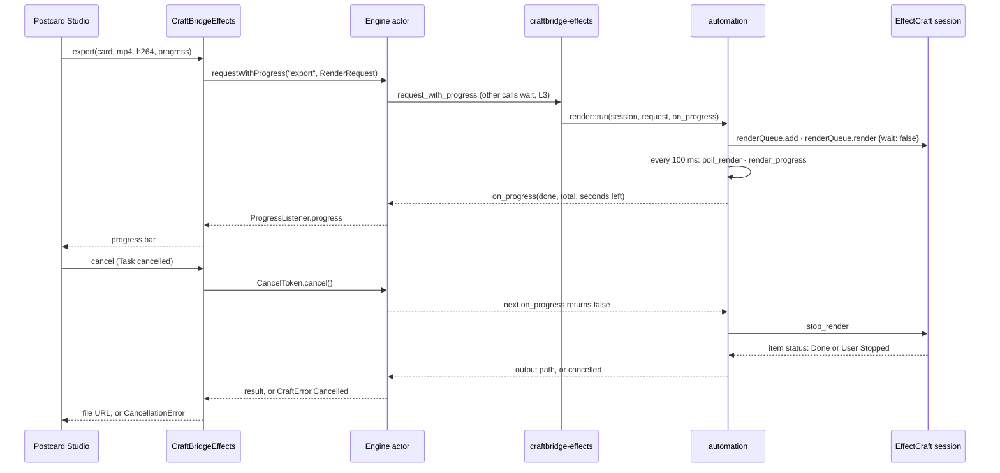

# EffectCraft Plugin Port — EFFECTCRAFT APP CRATE

<!-- GENERATED from EFFECTCRAFT-PLUGIN-PORT-SCOPING.md by build/build-plan.mjs — do not edit this file. -->
> **Generated view** of the plan of record [`EFFECTCRAFT-PLUGIN-PORT-SCOPING.md`](../EFFECTCRAFT-PLUGIN-PORT-SCOPING.md) (rendered: [`EFFECTCRAFT-PLUGIN-PORT-PLAN.html`](../EFFECTCRAFT-PLUGIN-PORT-PLAN.html)). Edit the master, then run `node build/build-plan.mjs`.

## 19. EffectCraft app crate design

`craftbridge-effects` implements `CraftApp` for EffectCraft. It owns one `McpServer`, which owns the `Backend`, which owns the session; every method reaches the session through `McpServer::backend` (`effectcraft: crates/automation/src/server.rs:58-60`), so the MCP endpoint and the API act on the same document (C11). Lints as `craftbridge-core`.

| File | Change | What |
|---|---|---|
| `Cargo.toml` | NEW | `effectcraft-engine`, `-host`, `-automation`, `-gpu` from the workspace pins; `[target.'cfg(target_os = "android")'.dependencies] boa_engine = { version = "0.22", features = ["jsvalue-enum"] }` (D-8) |
| `src/app.rs` | NEW | `EffectCraftApp`: construction, GPU attach, the method table of §14 |
| `src/methods.rs` | NEW | one function per method, each calling the upstream function named in §14's table |
| `src/plugins.rs` | NEW | PD13: plug-in policy |
| `src/info.rs` | NEW | `info`: engine version and pin from the generator's constants (§21), counts, GPU and decoder state |

**Construction.**
1. `effectcraft_host::session_in(&HostDirs { config, models, plugins, cache, fonts })` (S1) builds the wired session. On iOS and Android it carries no helper hooks (S2).
2. **Plug-ins (PD13):** with `Folders.plugins = None`, `session.plugin_loader` and `session.plugin_previewer` are `None` (fields at `effectcraft: crates/engine/src/lib.rs:207-215`), so no WebAssembly plug-in loads. On Android the loader is `effectcraft_plugin::loader` (`crates/plugin/src/lib.rs:61`). On iOS it is `plugins::bundle_loader`, a function with the same `PluginLoader` signature (`crates/engine/src/lib.rs:294`; the bundle path sits in a process-wide `OnceLock` set at start, because the signature is a plain function pointer) that refuses any `source` outside the bundle's plug-ins folder with `Unsupported` and otherwise calls `effectcraft_plugin::loader`, so a script or command cannot load a plug-in from the container (T24).
3. `Backend::headless(session)` then `Backend::confine(Confinement::new(read: [container, bundle], write: [container]))` (L5).
4. `McpServer::new(backend)`.
5. `attach_gpu` builds `Gpu::new(adapter, device, queue)` from the core's device and sets `session.accel` (§17).

**Export (`export`, `template.render`), the main runtime flow:**

`render::run` (S4) is the CLI's queue-and-wait code moved into the library: it unqueues the project's other items, adds this one, starts the render without waiting, polls every 100 ms and reads each item's status (`apps/effectcraft-cli/src/main.rs:958-1035`). New in the library, it calls `on_progress(done, total, seconds_left)` on each poll and `Session::stop_render` (`crates/engine/src/render_queue.rs:691-692`) when `on_progress` returns `false`. The CLI calls it with its terminal printer; CraftBridge with the listener.

**Other methods** follow §14's table: `exec` and `run` through `Backend::exec` with `automation::render_failure` (S4); `props`, `get`, `set` through the tools; `frame` through `FrameRequest::resolve` (S4) then `Session::render_rgba8_alpha` or `Backend::render_with`; `template.open` and `template.render` through `automation::template` (S4); `script` through the `script.run` command; `replay` through `effectcraft_engine::replay::run` on `Backend::session` (`crates/automation/src/backend.rs:61-66`); `timings` through `automation::bench` (S5); `mcp` through `McpServer::handle_line`.

**States** (per call): success · `InvalidParams` (unknown key, bad JSON) · `NotFound` (comp, layer, property, template control) · `CommandFailed` (the engine's message; `run` adds the step) · waiting in order during an export (L3) · `Cancelled` · `Unsupported` (helper effects; plug-ins switched off; a script asking for a helper) · `Io` (outside the confinement).

**Edge cases.**
- A template whose font is missing on the phone: EffectCraft substitutes a fallback and reports it in the template result's warnings, as on the desktop; the Swift and Kotlin layers surface `warnings`.
- A script that opens a ScriptUI window: there is no window on a phone; `script` returns the script's output and the engine's message about the window.
- `run` with many steps: they run in order on the actor, and the call returns after the last step or at the first failure with its step index, as the CLI's `run` does (`apps/effectcraft-cli/src/main.rs:732-740`). The CLI's 100,000-step limit guards text read from files and standard input (`:371-374`); a step array an app builds in memory needs no such guard.

**Tests.** The desktop conformance suite runs every method on macOS and compares results with the CLI's on the same inputs (§28, QA-1).
