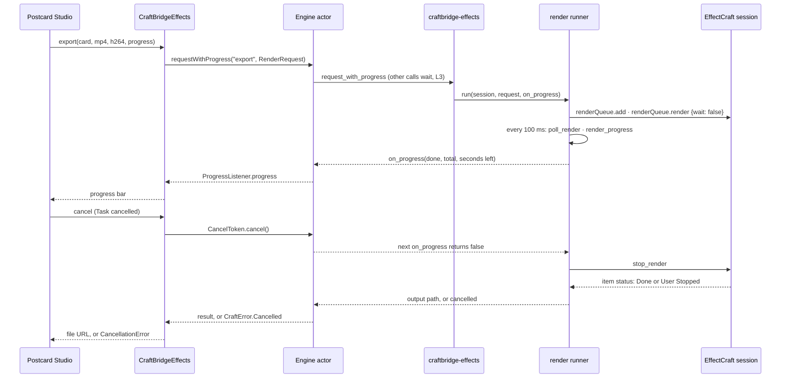

# EffectCraft Plugin Port — EFFECTCRAFT APP CRATE

<!-- GENERATED from EFFECTCRAFT-PLUGIN-PORT-SCOPING.md by build/build-plan.mjs — do not edit this file. -->
> **Generated view** of the plan of record [`EFFECTCRAFT-PLUGIN-PORT-SCOPING.md`](../EFFECTCRAFT-PLUGIN-PORT-SCOPING.md) (rendered: [`EFFECTCRAFT-PLUGIN-PORT-PLAN.html`](../EFFECTCRAFT-PLUGIN-PORT-PLAN.html)). Edit the master, then run `node build/build-plan.mjs`.

## 19. EffectCraft app crate design

`craftbridge-effects` implements `CraftApp` for EffectCraft. It owns one `McpServer`, which owns the `Backend`, which owns the session; every method reaches the session through `McpServer::backend` (`effectcraft: crates/automation/src/server.rs:58-60`), so the MCP endpoint and the API act on the same document (C11). Lints as `craftbridge-core`.

| File | Change | What |
|---|---|---|
| `Cargo.toml` | NEW | `effectcraft-engine`, `-host`, `-automation`, `-gpu`, `-render`, `-time`, `-text`, `-media`, `-expr`, `-script`, `-plugin` and `-raster` from the workspace pins; `craftbridge-core`, and `craftbridge-media` for the hardware encoders (§18), with `image` and `symphonia` to read the Targa frames and the WAV the hardware export takes from EffectCraft's; `[target.'cfg(target_os = "android")'.dependencies] boa_engine = { workspace = true, features = ["jsvalue-enum"] }`, the workspace's entry being EffectCraft's own `{ version = "0.22", default-features = false }`, so Android's boa adds the layout and nothing else (D-8) |
| `src/app.rs` | NEW | `EffectCraftApp`: construction and its confinement (AD9), GPU attach, the method table of §14 |
| `src/methods.rs` | NEW | `commands`, `exec` and `run`, each calling the upstream function named in §14's table, the one door every command passes, the one mapping of EffectCraft's failures onto §14's rows (AD10), the model downloads withheld at the door (AD11) and the renders nothing has listed (§19) |
| `src/plugins.rs` | NEW | PD13: plug-in policy |
| `src/reference.rs` | NEW | a comp or layer reference read as the command line's `reference` reads it (`main.rs:293-298`), for the methods whose commands read theirs that way (`render-frame`, `props`, `get`, `set`), so each finds what its command finds for the same words. `export` and `timings` hand the engine their `comp` as given, as `render` and `bench` do (`main.rs:906-907`, `:1072-1073`): the engine reads a name before digits, and `-` as a name |
| `src/info.rs` | NEW | `info` (AD10): engine version and pin from the generator's constants (§21), counts, GPU and decoder state |
| `src/properties.rs` | NEW | `props`, `get` and `set` through the tools (AD13) |
| `src/files.rs` | NEW | `open`, `save`, `saveAs` and `new` through the file commands, by the door every command passes (AD13) |
| `src/session.rs` | NEW | AD1: the session from EffectCraft's public fields with the app's folders, its exporter (AD7's) set from the one function that chooses it; AD2: the phone's fonts, and the font-list filter every app-facing call answers through |
| `src/fonts.rs` | NEW | AD2 (FX-3): at engine start, `add_source` with the phone's folders — on iOS the parent folders of the files the core's CoreText answer lists, on Android `/system/fonts`, plus `Folders.fonts` — and the listing filter every app-facing call answers through, applied to the value `src/methods.rs`'s `execute` returns, the door `exec` and every `run` step pass, and by the `mcp` line on its tools' answers: a `text.fonts` answer, and its rows inside `engine.batch` results (steps found by `command`, else `id`, as the engine reads them), keeps, as `bundled`, the app's `Folders.fonts` files and EffectCraft's statics, and the faces whose (file, PostScript name) CoreText reports (origin `system`), through one face list for the process that grows with every engine start, as the registry does; each kept family lists only the kept faces' styles and `count` recounts; where the platform answers no face list (Android, desktop) the listing passes through untouched. The bundled Noto Sans SC and Noto Sans TC OTFs ship in the crate's `assets/fonts/` beside their OFL license and provenance; an app delivers that folder as a `Folders.fonts`, which is how the simulator and emulator tests reach them |
| `src/requests.rs` | NEW | AD3 `RenderRequest` and AD4 `FrameRequest`, which refuses a request naming both `time` and `frame`, or both `maxSide` and `scale`, as `InvalidParams`: the usage of `render-frame` gives them as alternatives, where its code lets `--frame` and `--scale` win (§14) |
| `src/runner.rs` | NEW | AD3: the render runner, which lists the render's files before it starts (§19) |
| `src/templates.rs` | NEW | AD5: the template runner: `template.open`, `template.render` and the template half of `frame`, which set an instance up as the command line's `--template` does and export it through the render runner |
| `src/staging.rs` | NEW | AD5: the staging of a source the session may read from a folder it may not write: a copy in the app's staged working folder, which the import reads so what it writes beside the source lands inside the container and outlives any cache the system empties (§19) |
| `src/outputs.rs` | NEW | AD19: the files a render may write, handed to `list_outputs` (§19), and the chunked listing every runner uses |
| `src/fill.rs` | NEW | AD20: the fill runner, which lists a Content-Aware Fill's frames before it starts the fill's task (§19) |
| `src/timings.rs` | NEW | AD6 |
| `src/hardware.rs` | NEW | AD7: the exporter `Session.exporter` is set to: `FileExporter` through `src/exporter.rs`'s pools, and for an H.264 or HEVC job whose request chose `hardware` the Targa sequence and WAV run, the frames' conversion and order and the call into `craftbridge-media`'s encoders (§18); the choice is that of the one request being rendered (an `export`'s parameters or a `template.render`'s `output`), held by the app for the length of that call |
| `src/exporter.rs` | NEW | AD7: CraftBridge's exporter, `FileExporter` run on a rayon pool sized from the core's `available_memory()` and the job's largest frame (the caller's own pool when that is its size, otherwise one kept from job to job), the one `Session.exporter` is set to (through `src/hardware.rs`) |

**Construction.**
1. CraftBridge builds the session (AD1): `Session { models_dir, plugins_dir, footage: MediaPool::new(), importer, exporter, expr, expr_check, plugin_loader, plugin_previewer, ..Default::default() }` with the app's folders, CraftBridge's exporter (AD7) and no helper hooks, then `effectcraft_script::install`, then the phone's fonts (AD2).
2. **Plug-ins (PD13):** with `Folders.plugins = None`, `session.plugin_loader` and `session.plugin_previewer` are `None` (fields at `effectcraft: crates/engine/src/lib.rs:207-215`), so no WebAssembly plug-in loads. On Android the loader is `effectcraft_plugin::loader` (`crates/plugin/src/lib.rs:61`). On iOS it is `plugins::bundle_loader`, a function with the same `PluginLoader` signature (`crates/engine/src/lib.rs:294`; the plug-in folder each iOS engine names inside its bundle is added, resolved, to a process-wide list at start and taken out again when the app is dropped, because the signature is a plain function pointer, and a folder outside the bundle is never added) that refuses any `source` that does not resolve inside such a folder with `Unsupported` and otherwise calls `effectcraft_plugin::loader`, so a command cannot load a plug-in from the container (T24).
3. `Backend::headless(session)` then `Backend::confine(Confinement::new(read: [container, bundle], write: [container]))` (L5, AD9).
4. `McpServer::new(backend)`.
5. `attach_gpu` builds `Gpu::new(adapter, device, queue)` from the core's device and sets `session.accel` (§17).

**Export (`export`, `template.render`), the main runtime flow:**

The render runner (AD3) does what the CLI's queue-and-wait loop does (`apps/effectcraft-cli/src/main.rs:962-1033`), written in CraftBridge on EffectCraft's public render-queue commands: it unqueues the project's other items, adds this one, starts the render without waiting, polls every 100 ms and reads each item's status. It calls `on_progress(done, total, seconds_left)` on each poll and `Session::stop_render` (`crates/engine/src/render_queue.rs:691-692`) when `on_progress` returns `false`. Once its item is queued and before `renderQueue.render`, the runner hands `list_outputs` (§16, D-17) every file the render can write (AD19, `src/outputs.rs`), for each queued item and each of its output modules as the render resolves them (`Session::outputs_of`, `crates/engine/src/render_queue.rs:552-572`, crate-private in the pin, so the runner follows its rules over public parts of `Backend::session`: `Session::resolve_output` per output module, `:456-495`, Append Bit Depth to File Name, `crates/engine/src/settings/prefs/queries.rs:140-158`, and `Session::segments`, `crates/engine/src/render_queue.rs:501-537`): every file of an image sequence (`sequence_path`, `crates/project/src/render_queue.rs:1670-1673`, over the item's frames from the first of its span, since a PNG export asked for at `card.png` writes `card_00000.png` on and never `card.png`), the one file of a movie, every segment, and the render log (`log_path`, `:1546-1562`) of each. It hands them over in chunks and returns a refusal without rendering. Only the runner has the exporter write a render: `renderQueue.render`, the watch folder's two commands, `render.saveCurrentPreview` and `file.exportTimeline` (whose pre-renders go to a staging folder of a random name), which have it write one too, answer `Unsupported` whichever way a call reaches them, because no other call can list. The one call the door reads past that refusal is a `file.exportTimeline` whose own `prerender` says it renders nothing: the bool `false`, or `none`, `off`, `false` or `no` as EffectCraft parses them (`crates/interchange/src/export.rs:32-40`, `crates/engine/src/cmd/timeline.rs:169-174`), a mode in which no layer plans a pre-render (`crates/interchange/src/export.rs:192-197`), so the call writes only the one file its own `path` names; the door reads that parameter only where it passes to the engine untouched — a literal of `exec`, `run` or a batch step, never a `$N` a batch fills in as it runs. The runner does not otherwise touch the journal: the engine clears the list when the export ends, and the exporter's own removal of files on a clean cancel stays as it is. The conformance corpus runs it and the CLI on the same inputs (T9–T17), and its cancel on the plug-in alone (T22), since the CLI stops a render only by being killed.

The fill runner (AD20, `src/fill.rs`) answers `contentFill.generate` through `request_with_progress` the same way. The command writes its frames, `fill_00000.png` on, into one folder from a background task (`crates/engine/src/cmd/content_fill.rs:495-598`) that no other call sees, so the runner reads the call as the command does — the composition and layer a call names, the range, the frames the work area or the layer's span holds at the composition's frame rate, and the folder, the call's `outputDir` or the first `<layer>_Fill_<k>` that holds nothing — hands `list_outputs` every frame, and then gives the command exactly what it read (the composition and layer by id, the folder, the range, and no waiting), so it can write only what was listed. A call it cannot read as the command does is handed to the engine with a range the command refuses right after it resolves both, so it fails in the engine's own words and no fill starts. It then polls the task every 100 ms, relays the task's `(done, total)` with no estimate of the time left, and on `false` cancels the task and waits for its thread. A fill that ends without its frames, stopped or failed, then takes away any frame the call made that the engine kept (a stop that lands after the last frame finds the task done) and each folder the call made that then holds nothing (the engine removes only the fill's own folder, and its scratch file makes those above it too), as a kill's restart does. Before it lists, it checks the folder and every frame with the confinement's own write check (`crates/automation/src/confine.rs:190-206`), because the confinement checks the folder a call names only as a path it reads, a relative one not at all, and the folder the command picks for itself not at all, and the session's file services write wherever they are told (`:319-324`, `:360-366`, `:572-583`): a folder or frame outside the container, in the bundle, relative to the process, or the system's temporary folder an unsaved project's fill defaults to, is refused in the confinement's words whether or not the engine keeps a journal, where the command line's confined `mcp` would write it. The journal keeps the folder the fill makes apart from its frames (§16), so a killed fill's restart removes it once its frames are gone. The session's own write puts each file down through a temporary file beside it, named for the process and a count the engine keeps to itself (`crates/engine/src/services.rs:99-101`, `crates/engine/src/settings/config.rs:196-236`), which no listing can name, so the runner starts the task with the session's services wrapped by a writer of its own that writes each listed frame straight to its name (a link there is taken away first, as the session's rename over it would) and passes every other call on, and gives the session its own services back once the task has started: a frame a kill cuts short is one the journal lists. `contentFill.generate` and Content-Aware Fill Layer answer `Unsupported` whichever other way a call reaches them, through the door's one reader, since no other call can list.

**Other methods** follow §14's table: `exec` and `run` through `Backend::exec`, past the plug-in's door, which refuses the commands that start a render or generate a fill (§19); `props`, `get`, `set` through the tools; `open`, `save`, `saveAs` and `new` through the file commands (AD13); `frame` through `FrameRequest` (AD4) then `Session::render_rgba8_alpha` or `Backend::render_with`; `template.open` and `template.render` through the template runner (AD5); `replay` through `effectcraft_engine::replay::run` on `Backend::session` (`crates/automation/src/backend.rs:61-66`), which runs its lines past `Backend::exec`, so every line is first checked with the confinement and the plug-in's door (AD11, §19) and a refused repro script runs nothing; `timings` through CraftBridge's timings (AD6); `mcp` through `McpServer::handle_line`, with the plug-in's door (AD11, §19) held on the tool calls that run a command, and with each font listing among their replies trimmed as `exec`'s are (AD2).

**Scripts are not part of the phone build** (PD13). A script reaches the engine through `app.run`, `__exec` and `Session::execute_for_script` (`effectcraft: crates/script/src/prelude.js:2076`, `crates/script/src/runtime.rs:128-155`, `crates/engine/src/session/dispatch.rs:58-63`), and none of them passes `check_command`, which only `Backend::exec` runs (`effectcraft: crates/automation/src/backend.rs:70-82`), or the AD11 door: a script run on the confined session writes a project file outside the write root and reaches a model download past AD11's refusal. No hook of CraftBridge's can close that without changing EffectCraft (AGENTS §7), so no interface offers `script`: every interface calls the engine's methods directly, and an app that wants what a script does runs the same calls in succession through `exec` and `run`, which stay behind the confinement, so L5 and AD11 hold as written. `request("script")` answers `Unsupported` as it answers any name the table does not carry, and every command that runs a script (`RUNS_SCRIPTS`: `script.run`, `file.runScript`, the startup and shutdown scripts and the ScriptUI panels, `effectcraft: crates/engine/src/cmd/scripts.rs:34-35`) is refused by the confinement in its own words, on its own, as a step of `run` or of an `engine.batch`, as a line of a `replay` script and through each tool of the MCP server, `run_script` included. The session still carries the script runner EffectCraft's own host installs after filling the fields, because no call of the phone's reaches it. `script` returns only through a new decision, if EffectCraft offers a confinable script runner (a command gate on `execute_for_script`).

**States** (per call): success · `InvalidParams` (unknown key, bad JSON) · `NotFound` (comp, layer, property, template control) · `CommandFailed` (the engine's message; `run` adds the step, as it does to every other row's message) · waiting in order during an export (L3) · `Cancelled` · `Unsupported` (helper effects; plug-ins switched off; a command that runs a script, which the confinement withholds; the model downloads, AD11; an export format the build lacks; a name `request` or `request_with_progress` does not answer) · `Io` (outside the confinement, or a file the disk will not read or write).

**Edge cases.**
- A template whose font is missing on the phone: EffectCraft substitutes a fallback face and says nothing, on the phone as on the desktop, where the command line's `--template` prints nothing about it; the template runner answers the template's text layers whose font is missing as `warnings`, as `file.findMissing` reports them, and the Swift and Kotlin layers surface `warnings`.
- A template whose folder lies outside the container's write root, as `bundleURL("Birthday Card.ectemplate")`'s does (§5): the import writes a template's media beside the template as it is named (`<stem> Media/`), so a template in the bundle would have them written into the bundle, which on iOS fails without a word and leaves the instance's media missing, and on Android, where the unpacked assets can be written, escapes the confinement. `template.open`, `template.render` and the template half of `frame` therefore read such a template from a copy in the app's staged folder, at `<staged>/<id>/` (§14), `<id>` a SipHash of the bytes the copy holds, made by CraftBridge's one staging (`src/staging.rs`), which asks the confinement's own write check of the folder holding the name the call gives, not of where a link there leads, and which knows nothing of templates, so any import that writes beside its source can read it the same way; a template whose folder may be written is imported where it is, and one the confinement does not let the session read is refused as before. The media written beside the copy belong to whatever project the copy's import joined, and a saved project names them, so the staged folder is one the system keeps: the copies are not in the cache, which iOS may empty while the app is not running, and a project saved with such an instance must find its media when it is opened again. A copy is named by what it holds, not by where its source sits, because an update installs the bundle at a new path on iOS and may change a file where it sits on Android: the same template wherever it is installed finds the copy it had, so no update leaves a set of copies and media that nothing names again; a template an update changed gets a copy of its own and is never read from the old one, whose media a project saved before the update still names; and two templates of one name share a copy only when they hold the same bytes.
- `run` with many steps: they run in order on the actor, and the call returns after the last step or at the first failure with its step index, as the CLI's `run` does (`apps/effectcraft-cli/src/main.rs:732-740`). The CLI's 100,000-step limit guards text read from files and standard input (`:371-374`); a step array an app builds in memory needs no such guard.

**Tests.** The desktop conformance suite runs every method on macOS and compares results with the CLI's on the same inputs (§28, QA-1).
