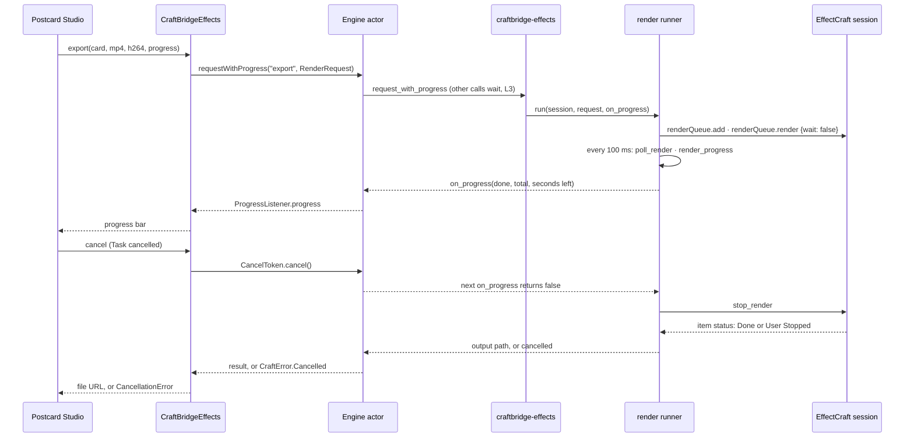

# EffectCraft Plugin Port — EFFECTCRAFT APP CRATE

<!-- GENERATED from EFFECTCRAFT-PLUGIN-PORT-SCOPING.md by build/build-plan.mjs — do not edit this file. -->
> **Generated view** of the plan of record [`EFFECTCRAFT-PLUGIN-PORT-SCOPING.md`](../EFFECTCRAFT-PLUGIN-PORT-SCOPING.md) (rendered: [`EFFECTCRAFT-PLUGIN-PORT-PLAN.html`](../EFFECTCRAFT-PLUGIN-PORT-PLAN.html)). Edit the master, then run `node build/build-plan.mjs`.

## 19. EffectCraft app crate design

`craftbridge-effects` implements `CraftApp` for EffectCraft. It owns one `McpServer`, which owns the `Backend`, which owns the session; every method reaches the session through `McpServer::backend` (`effectcraft: crates/automation/src/server.rs:58-60`), so the MCP endpoint and the API act on the same document (C11). Lints as `craftbridge-core`.

| File | Change | What |
|---|---|---|
| `Cargo.toml` | NEW | `effectcraft-engine`, `-host`, `-automation`, `-gpu`, `-render`, `-text`, `-media`, `-expr`, `-script` and `-plugin` from the workspace pins; `[target.'cfg(target_os = "android")'.dependencies] boa_engine = { version = "0.22", features = ["jsvalue-enum"] }` (D-8) |
| `src/app.rs` | NEW | `EffectCraftApp`: construction and its confinement (AD9), GPU attach, the method table of §14 |
| `src/methods.rs` | NEW | `commands`, `exec` and `run`, each calling the upstream function named in §14's table, the one door every command passes, the one mapping of EffectCraft's failures onto §14's rows (AD10), and the model downloads withheld at the door (AD11) |
| `src/plugins.rs` | NEW | PD13: plug-in policy |
| `src/reference.rs` | NEW | a comp or layer reference read as the command line's `reference` reads it (`main.rs:293-298`), for the methods whose commands read theirs that way (`render-frame`, `props`, `get`, `set`), so each finds what its command finds for the same words. `export` and `timings` hand the engine their `comp` as given, as `render` and `bench` do (`main.rs:906-907`, `:1072-1073`): the engine reads a name before digits, and `-` as a name |
| `src/info.rs` | NEW | `info` (AD10): engine version and pin from the generator's constants (§21), counts, GPU and decoder state |
| `src/properties.rs` | NEW | `props`, `get` and `set` through the tools (AD13) |
| `src/files.rs` | NEW | `open`, `save`, `saveAs` and `new` through the file commands, by the door every command passes (AD13) |
| `src/session.rs` | NEW | AD1: the session from EffectCraft's public fields with the app's folders, its exporter set from the one function AD7's exporter replaces; AD2: the phone's fonts, and the font-list filter every app-facing call answers through |
| `src/requests.rs` | NEW | AD3 `RenderRequest` and AD4 `FrameRequest`, which refuses a request naming both `time` and `frame`, or both `maxSide` and `scale`, as `InvalidParams`: the usage of `render-frame` gives them as alternatives, where its code lets `--frame` and `--scale` win (§14) |
| `src/runner.rs` | NEW | AD3: the render runner; AD5: the template runner |
| `src/timings.rs` | NEW | AD6 |
| `src/exporter.rs` | NEW | AD7: CraftBridge's exporter |

**Construction.**
1. CraftBridge builds the session (AD1): `Session { models_dir, plugins_dir, footage: MediaPool::new(), importer, exporter, expr, expr_check, plugin_loader, plugin_previewer, ..Default::default() }` with the app's folders, CraftBridge's exporter (AD7) and no helper hooks, then `effectcraft_script::install`, then the phone's fonts (AD2).
2. **Plug-ins (PD13):** with `Folders.plugins = None`, `session.plugin_loader` and `session.plugin_previewer` are `None` (fields at `effectcraft: crates/engine/src/lib.rs:207-215`), so no WebAssembly plug-in loads. On Android the loader is `effectcraft_plugin::loader` (`crates/plugin/src/lib.rs:61`). On iOS it is `plugins::bundle_loader`, a function with the same `PluginLoader` signature (`crates/engine/src/lib.rs:294`; the bundle path sits in a process-wide `OnceLock` set at start, because the signature is a plain function pointer) that refuses any `source` outside the bundle's plug-ins folder with `Unsupported` and otherwise calls `effectcraft_plugin::loader`, so a script or command cannot load a plug-in from the container (T24).
3. `Backend::headless(session)` then `Backend::confine(Confinement::new(read: [container, bundle], write: [container]))` (L5, AD9).
4. `McpServer::new(backend)`.
5. `attach_gpu` builds `Gpu::new(adapter, device, queue)` from the core's device and sets `session.accel` (§17).

**Export (`export`, `template.render`), the main runtime flow:**

The render runner (AD3) does what the CLI's queue-and-wait loop does (`apps/effectcraft-cli/src/main.rs:958-1035`), written in CraftBridge on EffectCraft's public render-queue commands: it unqueues the project's other items, adds this one, starts the render without waiting, polls every 100 ms and reads each item's status. It calls `on_progress(done, total, seconds_left)` on each poll and `Session::stop_render` (`crates/engine/src/render_queue.rs:691-692`) when `on_progress` returns `false`. The conformance corpus runs it and the CLI on the same inputs (T9–T17, T22).

**Other methods** follow §14's table: `exec` and `run` through `Backend::exec`, failed render items reported as the CLI reports them (AD3); `props`, `get`, `set` through the tools; `open`, `save`, `saveAs` and `new` through the file commands (AD13); `frame` through `FrameRequest` (AD4) then `Session::render_rgba8_alpha` or `Backend::render_with`; `template.open` and `template.render` through the template runner (AD5); `script` through the `script.run` command; `replay` through `effectcraft_engine::replay::run` on `Backend::session` (`crates/automation/src/backend.rs:61-66`); `timings` through CraftBridge's timings (AD6); `mcp` through `McpServer::handle_line`.

**States** (per call): success · `InvalidParams` (unknown key, bad JSON) · `NotFound` (comp, layer, property, template control) · `CommandFailed` (the engine's message; `run` adds the step, as it does to every other row's message) · waiting in order during an export (L3) · `Cancelled` · `Unsupported` (helper effects; plug-ins switched off; a script asking for a helper; the model downloads, AD11; a name `request` does not answer) · `Io` (outside the confinement, or a file the disk will not read or write).

**Edge cases.**
- A template whose font is missing on the phone: EffectCraft substitutes a fallback and reports it in the template result's warnings, as on the desktop; the Swift and Kotlin layers surface `warnings`.
- A script that opens a ScriptUI window: there is no window on a phone; `script` returns the script's output and the engine's message about the window.
- `run` with many steps: they run in order on the actor, and the call returns after the last step or at the first failure with its step index, as the CLI's `run` does (`apps/effectcraft-cli/src/main.rs:732-740`). The CLI's 100,000-step limit guards text read from files and standard input (`:371-374`); a step array an app builds in memory needs no such guard.

**Tests.** The desktop conformance suite runs every method on macOS and compares results with the CLI's on the same inputs (§28, QA-1).
